# field-ripple

Push a sine-Gordon kink with a field and watch it behave like a relativistic particle. A C11 scalar field theory in 1+1 dimensions, `φ_tt = φ_xx − sin φ`, a standard toy model that shares its structure with quantum field theory.
(C言語の1+1次元スカラー場シミュレータ。場の孤立波(キンク)を押して、ローレンツ収縮と速度の上限を観察します。)

**Theory handbook:** [docs/theory](docs/theory/README.md) states every law, numerical rule and game rule the code relies on (26 statements), each with a figure, the function that implements it and the test or measurement that checks it. `make theory-figs` regenerates the figures from the solver; `make theory-check` verifies the coverage table.
(理論の手引き: コードが拠る法則・数値計算の規則・ゲームの規則を、図・実装箇所・検査とともに `docs/theory` にまとめています。)

The browser observatory uses the same C solver, with live field and energy-density plots, a stationary reference curve, keyboard/touch forces and an original illustrated laboratory.
(同じ C の計算をブラウザーでも実行し、場・エネルギー密度・ローレンツ収縮を実測表示します。)

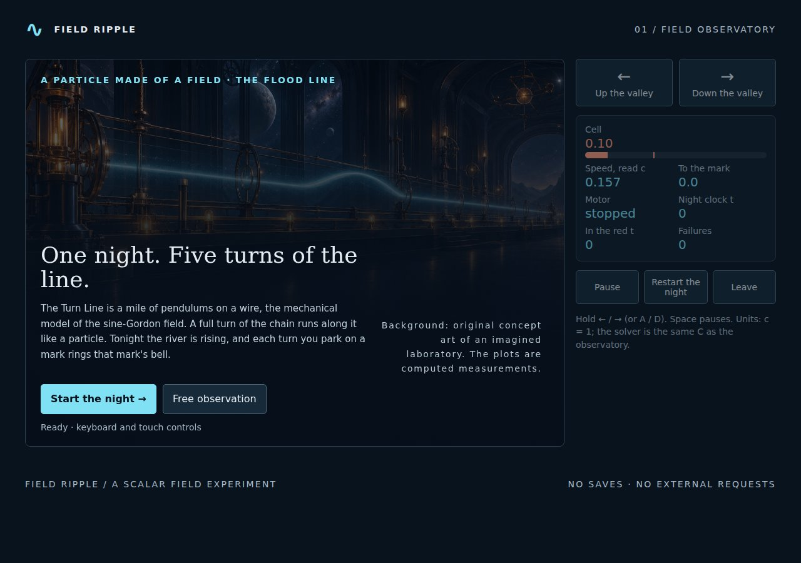

## The Flood Line

The Turn Line is a mile of pendulums on a wire coupled by torsion springs, the mechanical model of the sine-Gordon equation: a full turn of the chain (the kink) runs along it like a particle, and a winding motor puts the same torque on every pendulum (the bias `ε`). Tonight the river is rising. You keep the relay hut in the middle of the line and carry five turns between the marks; each turn that stands still on a mark rings that mark's bell. Ada keeps the dam hut at the top, Kit the catch arms at Lowfield at the bottom.
(洪水の夜、振り子の鎖 = sine-Gordon の力学模型で、turn(キンク)を 5 回、印まで運んで止める物語の層。)

- Hold **→ / D** (down the valley) or **← / A** (up the valley). The motor takes one period of the line's slowest ringing (2π t) to spin up and down, so you brake early. Bring the turn to the green mark and let it stand still with the motor off.
- The cell drains while the motor turns. In the red it is a crisis; empty, the motor stops (Kit cranks it, or later the turn is lost and Ada winds a fresh one).
- Two choices change the night: the mill bell or the church bell, and the ford bell or the hill siren. Each trades time for fewer failures: a longer bell route supplies charge, and the ford branch bypasses the leaking cell. The second choice also decides the ending.
- `src/line.c` sits on top of the unchanged `src/field.c`. Story scenes change only game numbers (charge, the next mark, how much the speed needle wobbles, a wet cell's leak, what a lost turn costs, the drum's torque). The words are in `web/app.mjs`; the beat sheet is `docs/narrative/beats.json`.

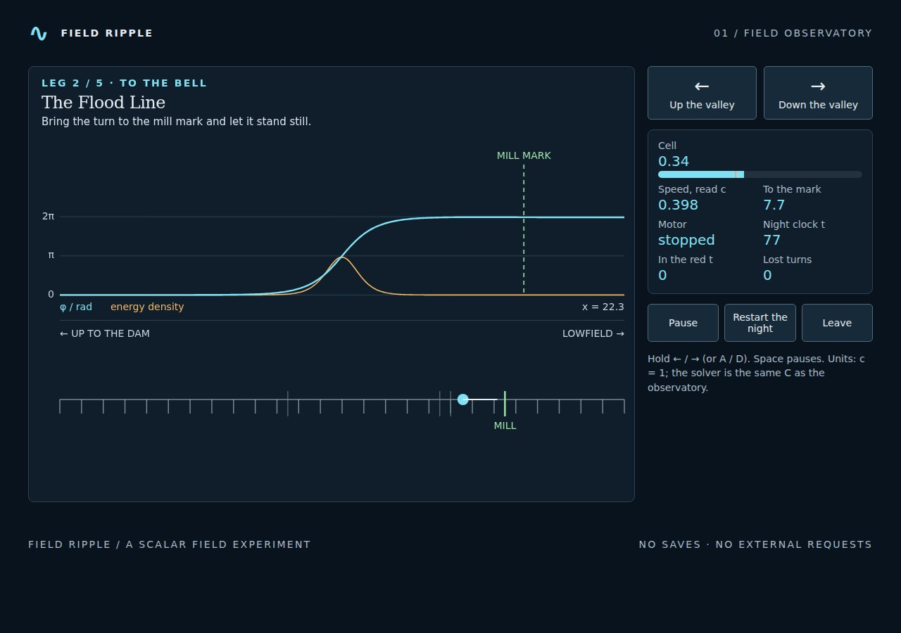
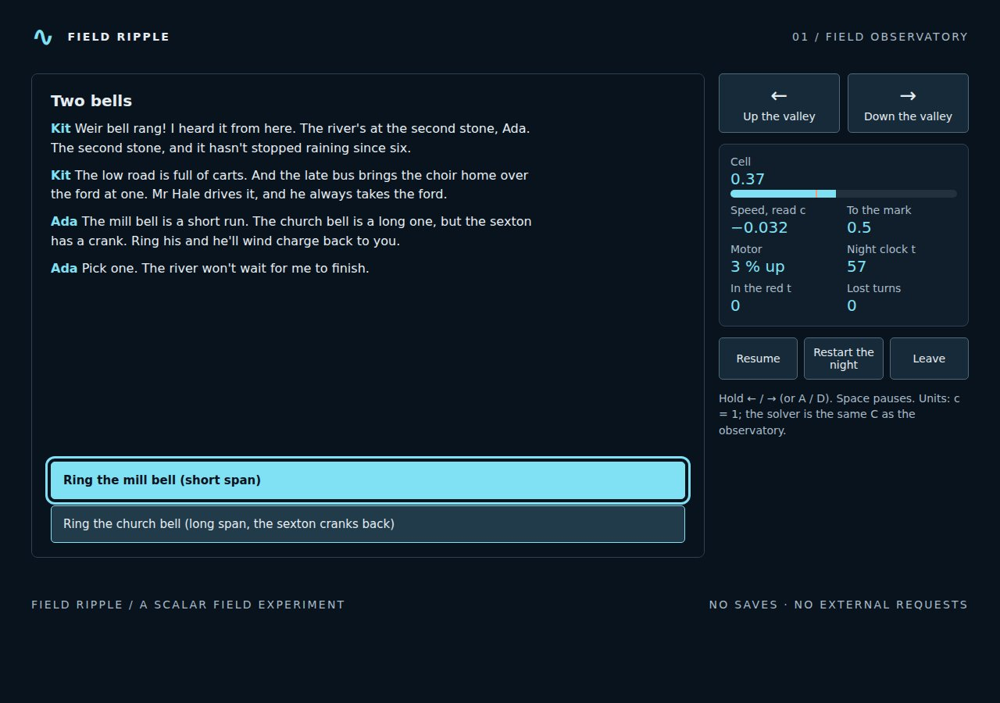
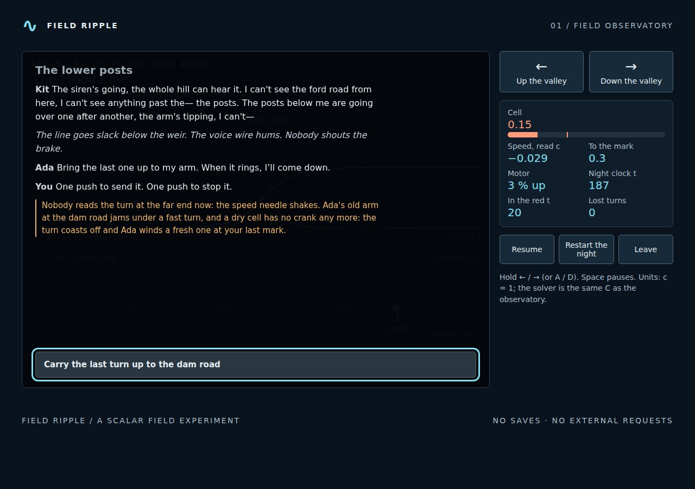
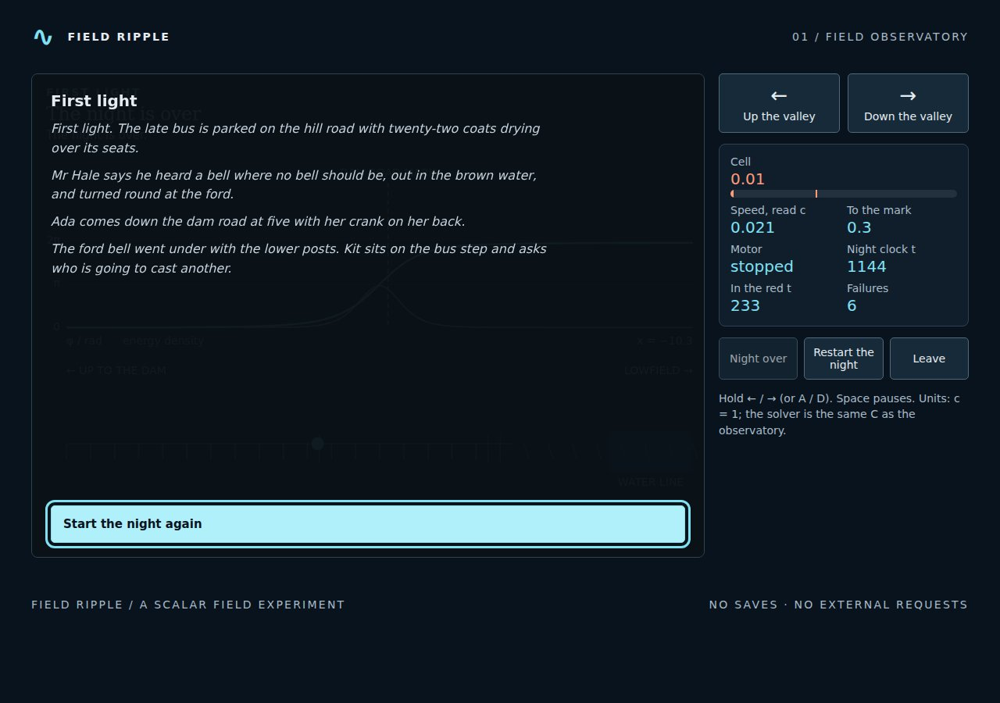
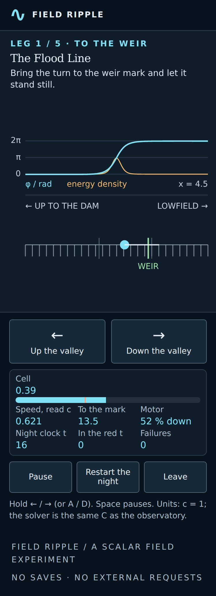

`make story` runs 972 nights (96 paired seeds for each ablation arm, plus scene-order and independent tension runs) with a keeper who reads only the gauges and writes `docs/narrative/{play-order,ablation,tension}.json`; `make test` checks the scene order, every story number, the quiet heavy scenes and both choices, and re-runs eight representative bench rows that must appear byte for byte. `make story-check` regenerates and compares every row. The two outcome metrics are the night clock and the HUD **Failures** counter; time in the red is a charge reading, recorded as `resource` and excluded from outcome tests. All four reward/punishment/loss beats must change both outcomes in the expected direction; each choice must give each path a measurable advantage. Generate and check them with Debian 13 GCC 14 and its libm (CI uses the Dockerfile; local checks can use the same Debian packages extracted into a temporary directory). See [outcome validation](docs/outcome-validation.md).

## Run

```sh
make && ./field-ripple          # interactive
./field-ripple --snapshot       # one frame, no terminal needed
./field-ripple --gif docs/demo.gif  # scripted push-and-brake run as an animated GIF
make test && make bench         # native physics, GIF and presentation-adapter checks
make plots                      # regenerate CSV, SVG and GIF
```

Keys: `a`/`d` push the kink left/right (a uniform bias term `ε` acts as a force), `p` pause, `q` quit. Park the kink on the `|` mark.

For the browser version, install the [Emscripten SDK](https://emscripten.org/docs/getting_started/downloads.html), activate it in the current shell, then run:

```sh
make web                       # builds dist/; enforces a 10,000,000-byte total budget
make play                      # serves the local observatory; open the printed address
```

The page opens on The Flood Line; **Free observation** opens the original observatory. There, choose an initial speed and press **Resume**, or hold **A / D**, **← / →**, or the on-screen force buttons. Release to coast; push in the opposite direction to brake. **Space** pauses (on a focused button it activates that button); **R** resets. Changing the initial speed resets and pauses the observation. All units are dimensionless, with `c = 1`. The view follows the kink; the position strip shows its location in the full domain.

The browser observation stops at `|x| ≥ 75` or `t ≥ 120`, before the kink reaches the finite grid edge. Reset to continue with a new observation. Focus loss pauses and releases held inputs. No save data, random numbers, external fonts or external requests are used.

### Actual screens / 実画面

Before M4: the existing terminal field rendering, retained below and in the animated demo.


After M4: the built C/WASM observatory at initial speeds 0.6 c and 0.9 c. The cyan measured curve narrows relative to the dashed stationary curve. Amber is measured energy density on its own labelled scale.

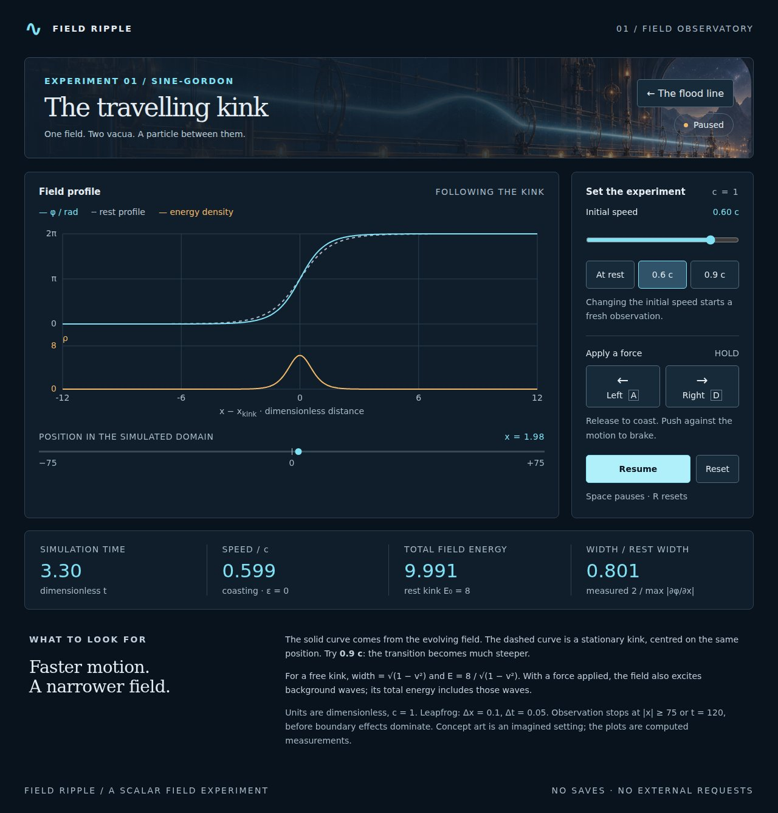
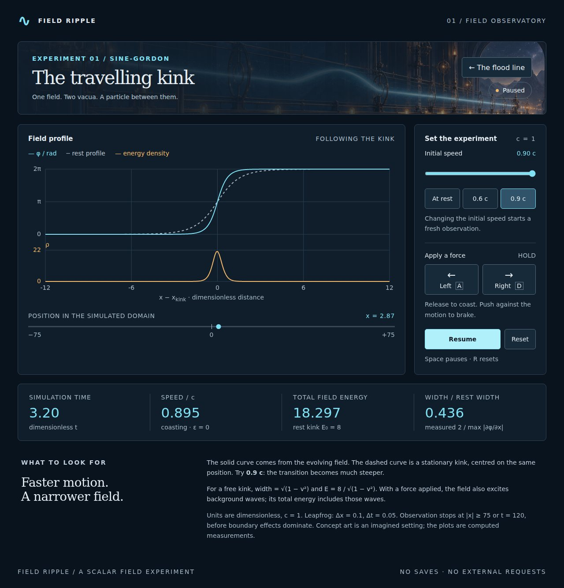
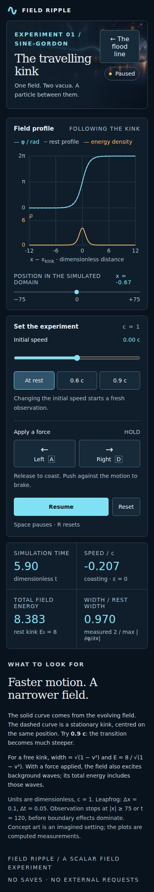

All observatory screenshots come from the actual application. The laboratory background is fictional concept art, not a scientific measurement. See [art direction and generation prompt](docs/art-direction.md) and [validation](docs/validation.md).

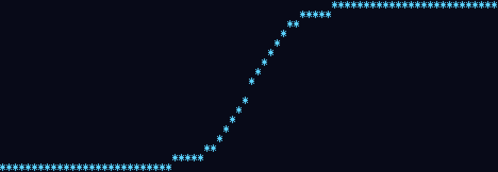

## Model

`φ_tt = φ_xx − sin φ + ε`, leapfrog with `dx = 0.1`, `dt = 0.05`. The kink `φ = 4 atan(exp(γ(x − vt)))` has rest energy 8 and a width `1/γ`; the energy is `8γ`, exactly like a particle of mass 8. For this rising kink the bias force is `−2πε`: positive bias pushes left. Its magnitude is `2π|ε|`, so the particle approximation gives `|p| = 2π|ε|t` and `|v| = |p|/√(p² + 64)`. The browser buttons choose the bias sign to match the indicated push direction.

These particle formulas describe an ideal kink. Applying a uniform bias also excites the surrounding field, so the displayed total field energy includes background waves. Width is measured as `2 / max |∂φ/∂x|`; the plotted energy density is `φ_t²/2 + φ_x²/2 + 1 − cos φ`. The two plots use separate vertical scales. Browser calls use [Emscripten's exported C functions and typed heap access](https://emscripten.org/docs/porting/connecting_cpp_and_javascript/Interacting-with-code.html); the solver has no JavaScript reimplementation.

## Results

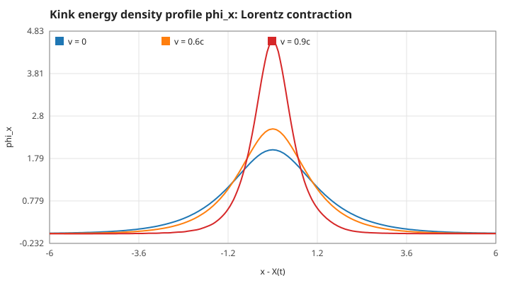
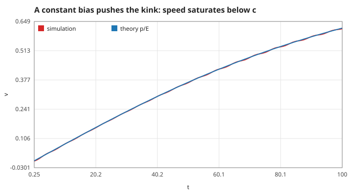
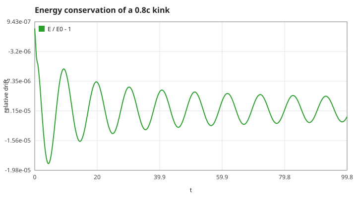

Pushed for 100 time units with `ε = 0.01`: simulated speed 0.614, particle theory 0.618.

## Tests

`tests/test_field.c` checks: static kink energy 8 and stays put, moving kink follows `x = vt`, energy `8γ` and conserved (1e-3), peak gradient `2γ` at v = 0, 0.6, 0.9 (Lorentz contraction), small waves follow `ω² = k² + 1`, the push matches `p/E`, renderer bounds.

`tests/test_observer.c` compares the browser adapter with the native solver, validates samples and input bounds, and checks both push directions, finite-domain stopping and reset. `make bench` measures free motion at 0, 0.6 and 0.9 c, energy drift, contraction and push/brake behavior.

Local browser verification (Node.js and Playwright Chromium required):

```sh
npm ci
npx playwright install chromium
make smoke
```

The smoke check uses real keyboard and touch input under a non-root URL path, checks numerical results, pause/reset/focus loss, observation limits, missing-art fallback and external requests, runs two whole Flood Line nights with real keys (both endings, heavy scenes with no banner), checks phone sizes upright and sideways (words 14 CSS px or more, targets 44 px or more, the plot over half the screen), and refreshes the screenshots. CI runs only `docker build .` (make test and make plots) on pull requests. Human first-use feedback, physical mobile devices and other browser engines are **unverified / 未検証**. This change does not deploy or submit the application.

## Roadmap

See the Issues: kink–antikink collisions and breathers, φ⁴ kinks, 2+1 dimensional fields.

Part of a series of small C physics toys, tracked in [algo-vis-panel](https://github.com/TM-59/algo-vis-panel/issues/6). MIT licensed.
