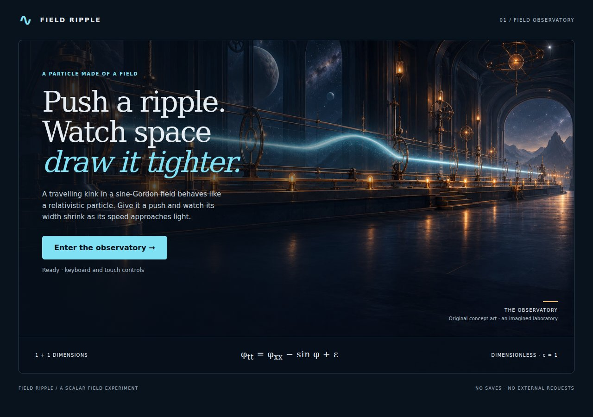
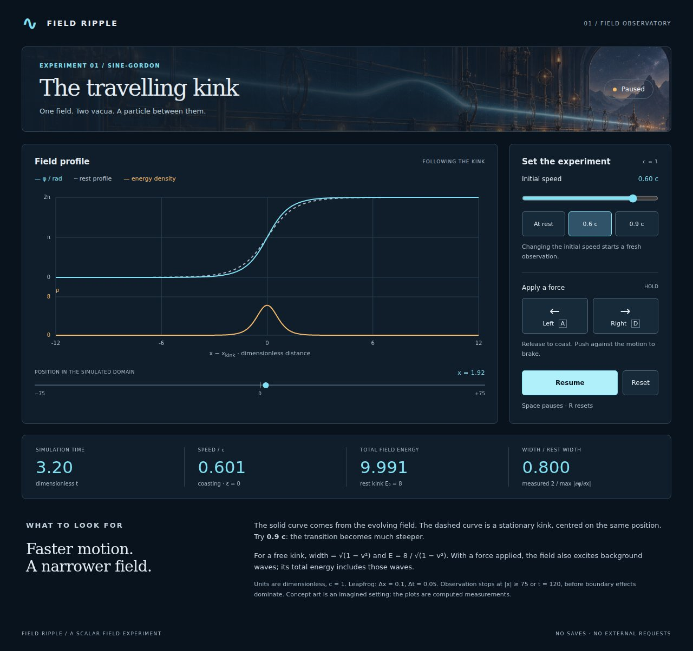
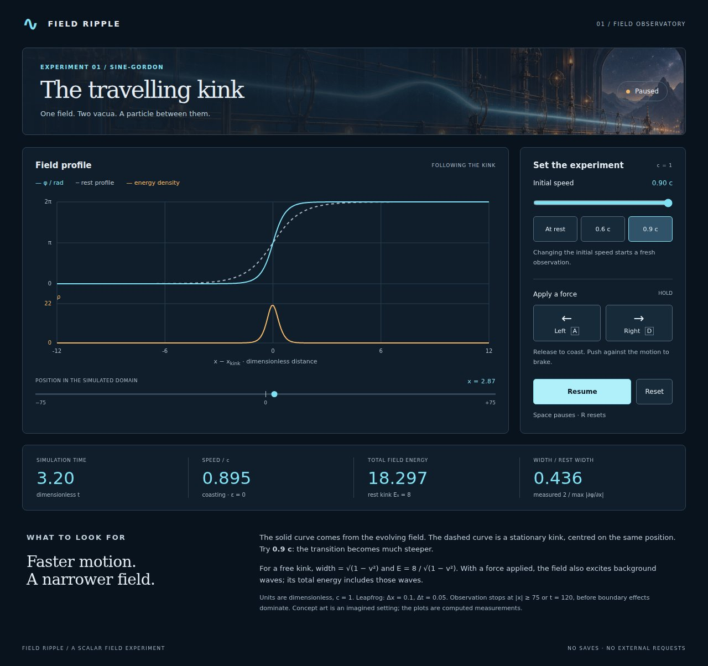
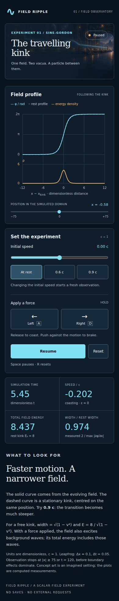

# field-ripple

Push a sine-Gordon kink with a field and watch it behave like a relativistic particle. A C11 scalar field theory in 1+1 dimensions, `φ_tt = φ_xx − sin φ`, a standard toy model that shares its structure with quantum field theory.
(C言語の1+1次元スカラー場シミュレータ。場の孤立波(キンク)を押して、ローレンツ収縮と速度の上限を観察します。)

The browser observatory uses the same C solver, with live field and energy-density plots, a stationary reference curve, keyboard/touch forces and an original illustrated laboratory.
(同じ C の計算をブラウザーでも実行し、場・エネルギー密度・ローレンツ収縮を実測表示します。)



## Run

```sh
make && ./field-ripple          # interactive
./field-ripple --snapshot       # one frame, no terminal needed
./field-ripple --gif docs/demo.gif  # scripted push-and-brake run as an animated GIF
make test && make bench         # native physics, GIF and presentation-adapter checks
make plots                      # regenerate CSV, SVG and GIF
```

Keys: `a`/`d` push the kink left/right (a uniform bias term `ε` acts as a force), `p` pause, `q` quit. Park the kink on the `|` mark.

For the browser version, install the [Emscripten SDK](https://emscripten.org/docs/getting_started/downloads.html), activate it in the current shell, then run:

```sh
make web                       # builds dist/; enforces a 10,000,000-byte total budget
make play                      # serves the local observatory; open the printed address
```

Choose an initial speed and press **Resume**, or hold **A / D**, **← / →**, or the on-screen force buttons. Release to coast; push in the opposite direction to brake. **Space** pauses (on a focused button it activates that button); **R** resets. Changing the initial speed resets and pauses the observation. All units are dimensionless, with `c = 1`. The view follows the kink; the position strip shows its location in the full domain.

The browser observation stops at `|x| ≥ 75` or `t ≥ 120`, before the kink reaches the finite grid edge. Reset to continue with a new observation. Focus loss pauses and releases held inputs. No save data, random numbers, external fonts or external requests are used.

### Actual screens / 実画面

Before M4: the existing terminal field rendering, retained below and in the animated demo.


After M4: the built C/WASM observatory at initial speeds 0.6 c and 0.9 c. The cyan measured curve narrows relative to the dashed stationary curve. Amber is measured energy density on its own labelled scale.





All observatory screenshots come from the actual application. The laboratory background is fictional concept art, not a scientific measurement. See [art direction and generation prompt](docs/art-direction.md) and [validation](docs/validation.md).


## Model

`φ_tt = φ_xx − sin φ + ε`, leapfrog with `dx = 0.1`, `dt = 0.05`. The kink `φ = 4 atan(exp(γ(x − vt)))` has rest energy 8 and a width `1/γ`; the energy is `8γ`, exactly like a particle of mass 8. For this rising kink the bias force is `−2πε`: positive bias pushes left. Its magnitude is `2π|ε|`, so the particle approximation gives `|p| = 2π|ε|t` and `|v| = |p|/√(p² + 64)`. The browser buttons choose the bias sign to match the indicated push direction.

These particle formulas describe an ideal kink. Applying a uniform bias also excites the surrounding field, so the displayed total field energy includes background waves. Width is measured as `2 / max |∂φ/∂x|`; the plotted energy density is `φ_t²/2 + φ_x²/2 + 1 − cos φ`. The two plots use separate vertical scales. Browser calls use [Emscripten's exported C functions and typed heap access](https://emscripten.org/docs/porting/connecting_cpp_and_javascript/Interacting-with-code.html); the solver has no JavaScript reimplementation.

## Results


Pushed for 100 time units with `ε = 0.01`: simulated speed 0.614, particle theory 0.618.

## Tests

`tests/test_field.c` checks: static kink energy 8 and stays put, moving kink follows `x = vt`, energy `8γ` and conserved (1e-3), peak gradient `2γ` at v = 0, 0.6, 0.9 (Lorentz contraction), small waves follow `ω² = k² + 1`, the push matches `p/E`, renderer bounds.

`tests/test_observer.c` compares the browser adapter with the native solver, validates samples and input bounds, and checks both push directions, finite-domain stopping and reset. `make bench` measures free motion at 0, 0.6 and 0.9 c, energy drift, contraction and push/brake behavior.

Local browser verification (Node.js and Playwright Chromium required):

```sh
npm ci
npx playwright install chromium
make smoke
```

The smoke check uses real keyboard and touch input under a non-root URL path, checks numerical results, pause/reset/focus loss, observation limits, missing-art fallback and external requests, and refreshes the four observatory screenshots. CI runs only native C unit tests on pull requests. Human first-use feedback, physical mobile devices and other browser engines are **unverified / 未検証**. This change does not deploy or submit the application.

## Roadmap

See the Issues: kink–antikink collisions and breathers, φ⁴ kinks, 2+1 dimensional fields.

Part of a series of small C physics toys, tracked in [algo-vis-panel](https://github.com/TM-59/algo-vis-panel/issues/6). MIT licensed.
