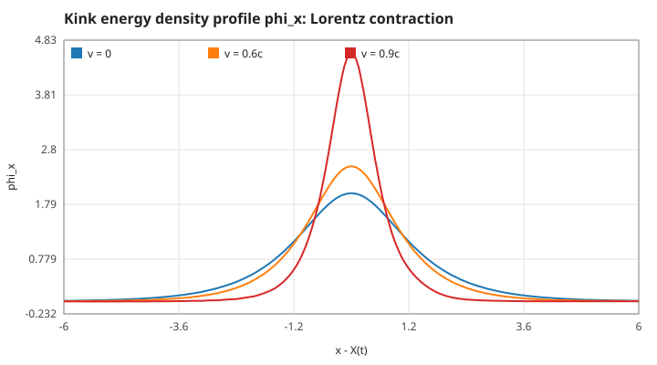
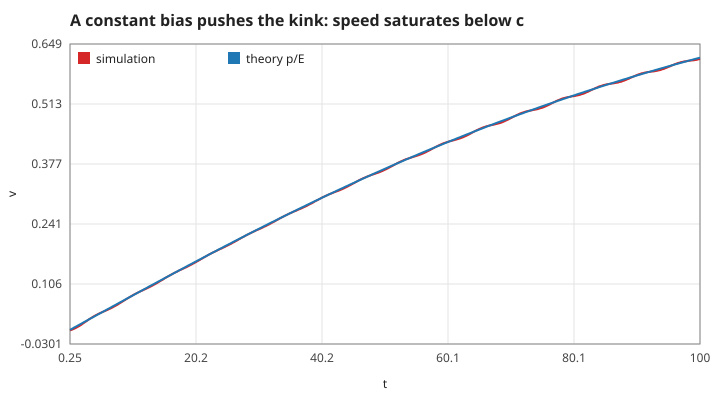
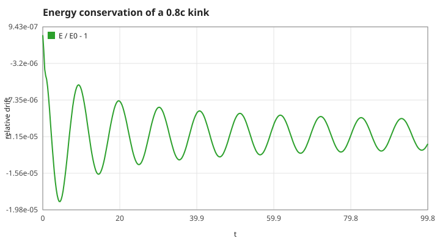

# field-ripple

Push a sine-Gordon kink with a field and watch it behave like a relativistic particle. A C11 scalar field theory in 1+1 dimensions, `φ_tt = φ_xx − sin φ`, a standard toy model that shares its structure with quantum field theory.
(C言語の1+1次元スカラー場シミュレータ。場の孤立波(キンク)を押して、ローレンツ収縮と速度の上限を観察します。)


## Run

```sh
make && ./field-ripple          # interactive
./field-ripple --snapshot       # one frame, no terminal needed
./field-ripple --gif docs/demo.gif  # scripted push-and-brake run as an animated GIF
make test && make plots         # unit tests and docs/*.svg
docker build -t field-ripple .  # same, reproducibly
```

Keys: `a`/`d` push the kink left/right (a uniform bias term `ε` acts as a force), `p` pause, `q` quit. Park the kink on the `|` mark.

## Model

`φ_tt = φ_xx − sin φ + ε`, leapfrog with `dx = 0.1`, `dt = 0.05`. The kink `φ = 4 atan(exp(γ(x − vt)))` has rest energy 8 and a width `1/γ`; the energy is `8γ`, exactly like a particle of mass 8. The bias `ε` produces a force `2πε`, so the kink accelerates relativistically with `p = 2πεt` and `v = p/√(p² + 64)` and can never reach `c`.

## Results





Pushed for 100 time units with `ε = 0.01`: simulated speed 0.614, particle theory 0.618.

## Tests

`tests/test_field.c` checks: static kink energy 8 and stays put, moving kink follows `x = vt`, energy `8γ` and conserved (1e-3), peak gradient `2γ` at v = 0, 0.6, 0.9 (Lorentz contraction), small waves follow `ω² = k² + 1`, the push matches `p/E`, renderer bounds.

## Roadmap

See the Issues: kink–antikink collisions and breathers, φ⁴ kinks, 2+1 dimensional fields.

Part of a series of small C physics toys, tracked in [algo-vis-panel](https://github.com/TM-59/algo-vis-panel/issues/6). MIT licensed.
