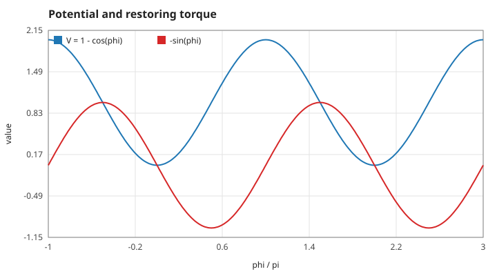
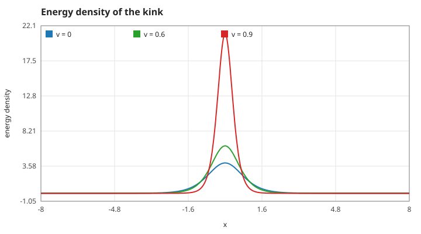
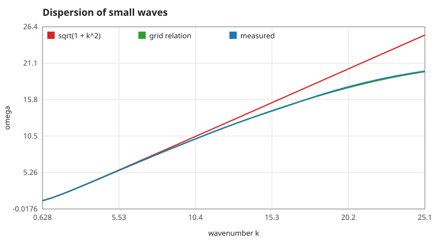
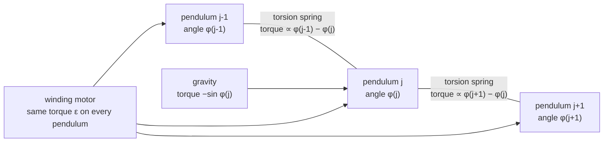

# 1. The sine-Gordon field

Units throughout: $c = 1$; $x$ and $t$ are measured in the field's own length and time (the inverse of its mass gap); $\phi$ is an angle in radians. Every number quoted here is taken from [figures/values.md](figures/values.md), which `make theory-figs` regenerates.

## S01 — Equation of motion

**Statement.** The field $\phi(x,t)$ obeys

$$\phi_{tt} = \phi_{xx} - \sin\phi + \varepsilon ,$$

where $\varepsilon$ is a uniform bias (a constant torque on every point of the line).

*Figure: the potential $V(\phi) = 1-\cos\phi$ and the restoring term $-\sin\phi$. The minima at $\phi = 0, 2\pi, \dots$ are the vacua; a kink (page 2) connects two neighbouring ones.*

**Assumptions and where they break.** One space dimension, no damping, and a bias that is the same everywhere. With $\varepsilon \neq 0$ the vacua shift to $\sin\phi = \varepsilon$, so the equation only has resting vacua for $|\varepsilon| < 1$; the game never exceeds $|\varepsilon| = 0.08$.

**Derivation.** It is the Euler–Lagrange equation of the Lagrangian density of S02 with the extra term $+\varepsilon\phi$: $\partial_t(\partial\mathcal L/\partial\phi_t) + \partial_x(\partial\mathcal L/\partial\phi_x) - \partial\mathcal L/\partial\phi = 0$ gives $\phi_{tt} - \phi_{xx} + \sin\phi - \varepsilon = 0$.

**Code.** `field_step` in `src/field.c` evaluates the right-hand side `lap - sin(f->cur[j]) + f->eps` (the discretisation is page 3).

**Tests.** Every test of `tests/test_field.c` runs this equation; `test_static_kink_stays_put_with_energy_eight` checks that an exact solution stays a solution.

## S02 — Lagrangian and energy

**Statement.**

$$\mathcal L = \tfrac12\phi_t^2 - \tfrac12\phi_x^2 - (1-\cos\phi), \qquad E = \int \Big[\tfrac12\phi_t^2 + \tfrac12\phi_x^2 + (1-\cos\phi)\Big]\,dx .$$

For $\varepsilon = 0$ the energy $E$ is conserved.

*Figure: the integrand of $E$ for a kink at three speeds, computed from the arrays the solver holds. The energy is concentrated in a lump whose area is $8\gamma$ (S08).*

**Assumptions.** Conservation needs $\varepsilon = 0$ and fields that are flat at the ends of the grid. With a bias, $E$ changes by the work the bias does (S09).

**Derivation.** Multiply the equation of motion by $\phi_t$: $\partial_t\big[\tfrac12\phi_t^2 + \tfrac12\phi_x^2 + 1-\cos\phi\big] = \partial_x(\phi_t\phi_x)$. Integrating over $x$ leaves only boundary terms, which vanish for a flat field.

**Code.** `field_energy` in `src/field.c`. It averages the gradient and potential terms over the two time levels the leapfrog scheme holds, so that the sum matches the time derivative taken between them (S13).

**Tests.** `test_energy_is_gamma_times_rest_energy`; measured value `kink-energy-v0.6` (9.99991 against 10).

## S03 — Small waves are massive: $\omega^2 = 1 + k^2$

**Statement.** Small ripples $\phi \ll 1$ around a vacuum obey the Klein–Gordon equation $\phi_{tt} = \phi_{xx} - \phi$, so a plane wave $e^{i(kx-\omega t)}$ has

$$\omega^2 = 1 + k^2 .$$

No wave oscillates slower than $\omega = 1$; that slowest period, $2\pi$, is the time scale the game's motor uses (S19).

*Figure: the continuum relation (red), the relation of the grid itself (green, S14) and frequencies measured from the solver (blue).*

**Assumptions and where they break.** Amplitude small enough that $\sin\phi \approx \phi$. On the grid the relation bends away from the continuum one at large $k$ (S14).

**Derivation.** Substitute $\sin\phi \to \phi$ and the plane wave into S01 with $\varepsilon = 0$.

**Code.** `field_set_wave` in `src/field.c` prepares the standing wave $A\cos kx$ at rest.

**Tests.** `test_small_waves_follow_the_massive_dispersion`; measured value `dispersion-k0.63` (1.18113 against 1.18101).

## S04 — The mechanical model: a chain of pendulums

**Statement.** A row of pendulums hanging from a common axle and coupled to their neighbours by torsion springs obeys, in the continuum limit, the sine-Gordon equation: $\phi$ is the angle of a pendulum, $\phi_{xx}$ the spring torque, $-\sin\phi$ gravity, and a torque applied equally to every pendulum is the bias $\varepsilon$. A kink is one full turn of the chain.

*Figure: the three torques on one pendulum. Their sum divided by the moment of inertia is the right-hand side of S01.*

**Assumptions.** Many pendulums per kink width (the continuum limit), no friction. The game's grid has 10 points per unit length, so a resting kink (width about 2) spans about 20 points.

**Derivation.** Newton's law for pendulum $j$: $I\ddot\phi_j = \kappa(\phi_{j+1} - 2\phi_j + \phi_{j-1}) - mgl\sin\phi_j + \tau$. Rescale $x$, $t$ and $\tau$ to absorb $I$, $\kappa$, $mgl$; the difference quotient becomes $\phi_{xx}$.

**Code.** The story layer is written in these words: see the header comment of `src/line.h` ("a long chain of pendulums coupled by torsion springs") and `line_torque`.

**Tests.** `tests/test_line.c` exercises the layer on the unchanged solver ("[mech] hut" and the following mechanism checks).

Reference: A. C. Scott, "A nonlinear Klein–Gordon equation", *American Journal of Physics* 37 (1969) 52; M. Remoissenet, *Waves Called Solitons*, 3rd ed., Springer (1999), ch. 6.
