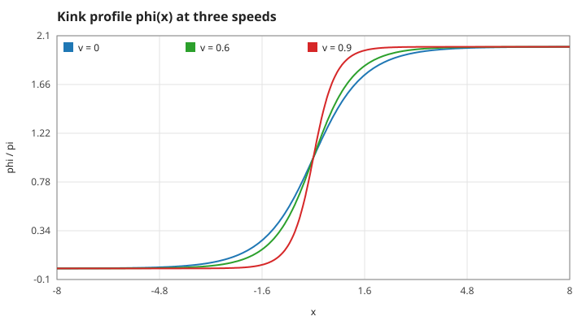
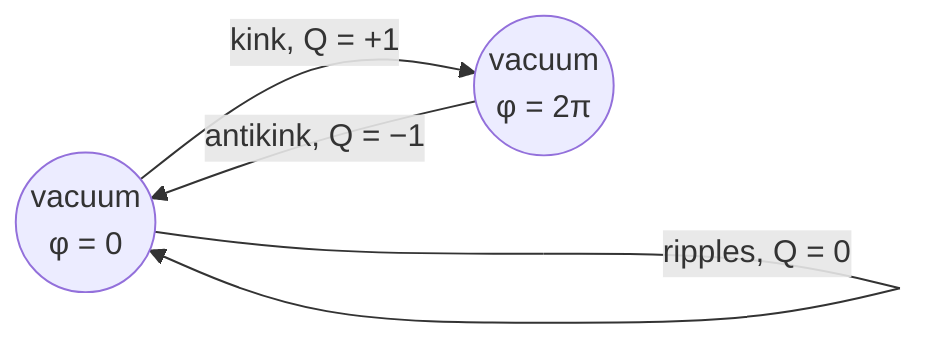
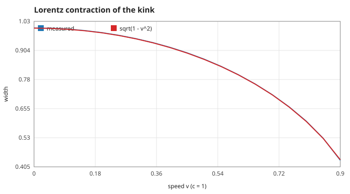
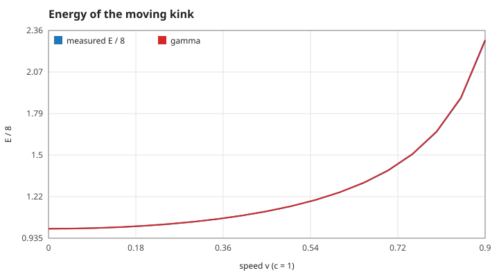
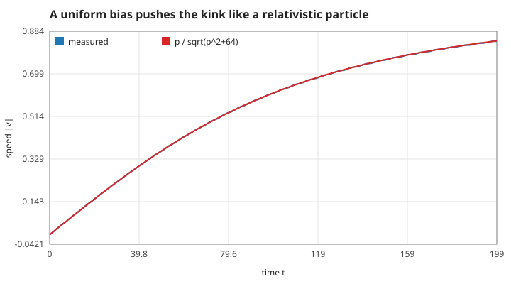
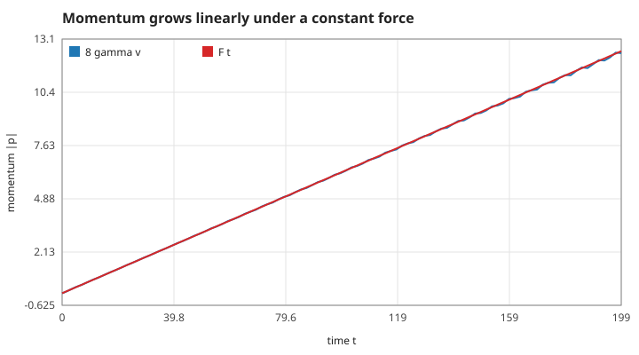

# 2. The kink

## S05 — The kink solution

**Statement.** For $\varepsilon = 0$ and any speed $|v| < 1$,

$$\phi(x,t) = 4\arctan\exp\big(\gamma\,(x - x_0 - vt)\big), \qquad \gamma = \frac{1}{\sqrt{1-v^2}},$$

solves S01 exactly. It rises from $0$ to $2\pi$; the antikink is $2\pi - \phi$.

*Figure: the profile written by `field_set_kink` at $v = 0, 0.6, 0.9$.*

**Assumptions and where they break.** No bias and an infinite line. On the grid the ends are a finite distance away; the tails are $\propto e^{-\gamma|x|}$, so 100 units of margin leave an error far below rounding.

**Derivation.** For a static field, S01 integrates once to $\tfrac12\phi_x^2 = 1-\cos\phi = 2\sin^2(\phi/2)$, i.e. $\phi_x = 2\sin(\phi/2)$, whose solution is $4\arctan e^{x-x_0}$. The equation is Lorentz invariant, so the boosted profile $x \to \gamma(x - vt)$ is also a solution.

**Code.** `field_set_kink` in `src/field.c` fills both time levels ($t = 0$ and $t = -dt$) from this formula.

**Tests.** `test_static_kink_stays_put_with_energy_eight`, `test_moving_kink_follows_its_worldline`; measured value `worldline-v0.6` (−8.00761 against −8 after $t = 20$).

## S06 — Topological charge

**Statement.** $Q = \dfrac{\phi(+\infty) - \phi(-\infty)}{2\pi}$ is an integer and cannot change in time: $Q = +1$ for a kink, $-1$ for an antikink, $0$ for ripples.

*Figure: a kink is a path from one vacuum to the next; ripples start and end in the same vacuum.*

**Assumptions.** Finite energy, which forces both ends into vacua. A grid end that is not flat (a kink running off the posts) breaks it; the game treats that as a lost turn (`RUNOFF` in `src/line.c`).

**Derivation.** $Q = \frac{1}{2\pi}\int\phi_x\,dx$ and $\partial_t\phi_x = \partial_x\phi_t$, so $\dot Q$ is a boundary term that vanishes when the ends sit in vacua.

**Code.** The sign argument of `field_set_kink` chooses $Q = \pm1$.

**Tests.** `test_static_kink_stays_put_with_energy_eight` (a kink does not unwind); measured value `kink-charge-v0.6` (0.999942 against 1 on a grid of half-width 8).

## S07 — Lorentz contraction

**Statement.** The gradient of a moving kink is $\phi_x = 2\gamma\,\mathrm{sech}\big(\gamma(x - vt)\big)$, so its width, defined as $w = 2/\max\phi_x$, is

$$w = \frac{1}{\gamma} = \sqrt{1 - v^2}.$$

*Figure: width measured after running the solver for $t = 20$ (blue) against $\sqrt{1-v^2}$ (red).*

**Assumptions and where they break.** The peak must be resolved by the grid: at $v = 0.9$ the width is 0.44, about four grid steps, and the measured value is 0.5 % low (`width-v0.9`).

**Derivation.** Differentiate S05.

**Code.** `field_max_gradient` and `field_gradient` in `src/field.c`; `fr_width` in `src/observer.c` reports $2/\max\phi_x$ to the screen.

**Tests.** `test_kink_is_lorentz_contracted`; measured value `width-v0.6` (0.800744 against 0.8).

## S08 — Rest energy 8 and $E = 8\gamma$

**Statement.** A resting kink has energy 8; a moving one has $E = 8\gamma$ and momentum $p = 8\gamma v$, exactly like a relativistic particle of mass 8.

*Figure: $E/8$ measured after $t = 20$ (blue) against $\gamma$ (red).*

**Assumptions.** The same as S05. The discrete energy carries a grid error of about $7\times10^{-4}$ on the game's grid (S13).

**Derivation.** For the static kink the three terms of S02 give $E = \int \phi_x^2\,dx = \int_0^{2\pi} 2\sin(\phi/2)\,d\phi = 8$. A Lorentz boost multiplies the energy of any localised solution by $\gamma$.

**Code.** `field_energy` in `src/field.c`; `fr_energy` in `src/observer.c`.

**Tests.** `test_energy_is_gamma_times_rest_energy`; measured value `energy-v0.6` (9.99124 against 10).

## S09 — A bias pushes the kink like a particle

**Statement.** Under a uniform bias the kink feels the constant force $F = -2\pi\varepsilon Q$ (a positive bias pushes a kink towards $-x$). Starting from rest,

$$p(t) = Ft, \qquad v(t) = \frac{p}{\sqrt{p^2 + 8^2}} .$$

*Figures: speed and momentum $8\gamma v$ measured from the kink's position (blue) against the particle formulas (red), for $\varepsilon = 0.01$.*

**Assumptions and where they break.** The bias must be small and switched on slowly compared with the slowest wave period $2\pi$; a sudden bias also sets the whole line ringing at $\omega \approx 1$ (S03), which is why the game ramps its motor (S19). The formula treats the kink as rigid; radiation is neglected.

**Derivation.** The bias adds $-\varepsilon\phi$ to the energy density. Moving a kink by $\delta$ changes that energy by $\varepsilon\cdot 2\pi Q\cdot\delta$, so the force is $-2\pi\varepsilon Q$. A constant force on a relativistic particle gives $p = Ft$ and $v = p/E$ with $E = \sqrt{p^2 + m^2}$, $m = 8$.

**Code.** `f->eps` in `field_step` (`src/field.c`); the game's motor sets it in `line_tick` (`src/line.c`), and the observatory in `fr_step` (`src/observer.c`).

**Tests.** `test_bias_pushes_the_kink_like_a_particle`; measured values `push-speed-t99` (0.61227 against 0.613826) and `push-momentum-t99` (6.19511 against 6.22035).

Reference: D. W. McLaughlin and A. C. Scott, "Perturbation analysis of fluxon dynamics", *Physical Review A* 18 (1978) 1652.
