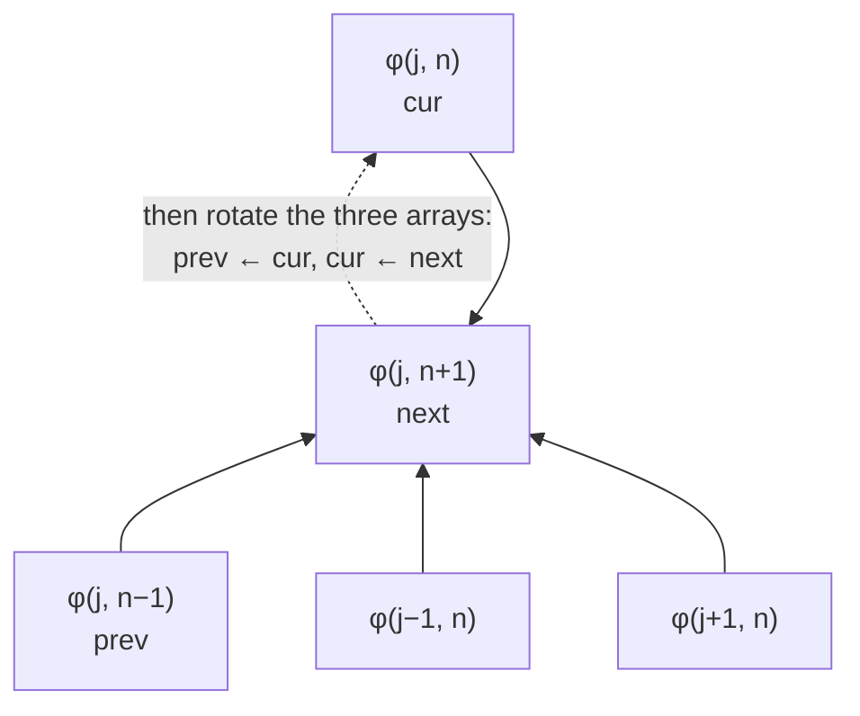
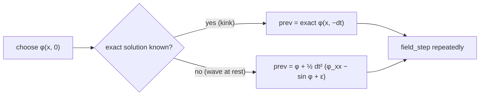
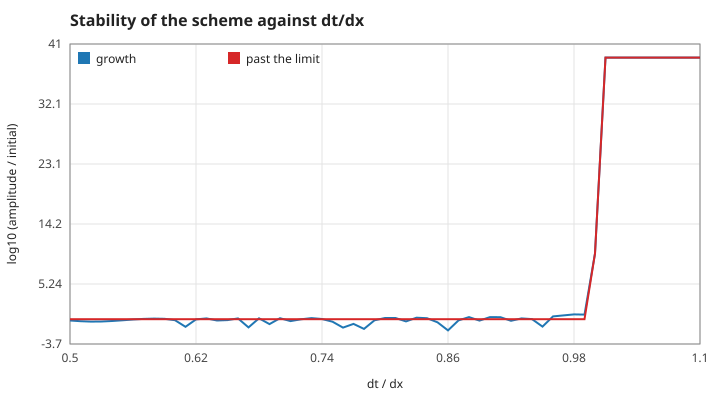
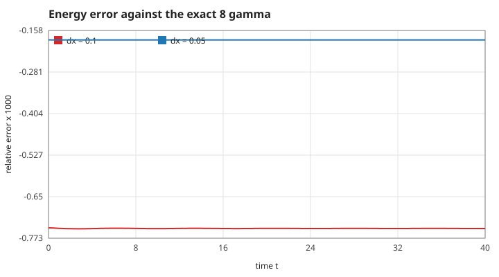
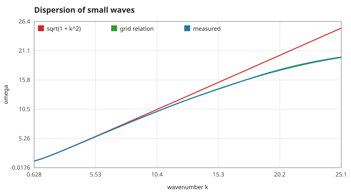

# 3. The numerical scheme

The game's grid: $dx = 0.1$, $dt = 0.05$ ($dt/dx = 0.5$), 2000 points in the observatory and 1200 in The Flood Line.

## S10 — The leapfrog update and its stencil

**Statement.** With $\phi_j^n \approx \phi(x_0 + j\,dx,\; n\,dt)$,

$$\phi_j^{n+1} = 2\phi_j^n - \phi_j^{n-1} + dt^2\left[\frac{\phi_{j+1}^n - 2\phi_j^n + \phi_{j-1}^n}{dx^2} - \sin\phi_j^n + \varepsilon\right].$$

*Figure: the five-point stencil. The new value needs the point itself at two earlier times and its two neighbours at the current time; nothing else.*

**Assumptions.** Uniform grid, fixed $dt$. The scheme is explicit, time-reversible and second-order accurate in both $dx$ and $dt$ (S13).

**Derivation.** Replace $\phi_{tt}$ and $\phi_{xx}$ in S01 by centred second differences, each with error $O(dt^2)$ and $O(dx^2)$, and solve for $\phi_j^{n+1}$.

**Code.** `field_step` in `src/field.c`; the three arrays are `prev`, `cur`, `next` of `Field` (`src/field.h`), rotated by pointer swap.

**Tests.** All of `tests/test_field.c`; `tests/test_observer.c` checks that the browser adapter takes exactly these steps (`fr_position` equals `field_kink_position` of a reference run to $1\times10^{-10}$).

## S11 — Starting the scheme: the level at $t = -dt$

**Statement.** The update needs two time levels. The start-up level is

- for a kink: the exact solution S05 evaluated at $t = -dt$;
- for a wave at rest: $\phi(-dt) = \phi(0) + \tfrac12 dt^2\,\phi_{tt}(0)$, with $\phi_{tt}$ from the right-hand side of S01.

*Figure: how the two initial conditions fill the `prev` array.*

**Assumptions.** The Taylor start assumes zero initial velocity; its error is $O(dt^4)$ per point, below the scheme's own.

**Derivation.** Taylor-expand $\phi(-dt) = \phi - dt\,\phi_t + \tfrac12 dt^2\phi_{tt} - \dots$ with $\phi_t = 0$.

**Code.** `field_set_kink` and `field_set_wave` in `src/field.c`.

**Tests.** `test_static_kink_stays_put_with_energy_eight` (a wrong start level would set the kink drifting); `test_small_waves_follow_the_massive_dispersion`.

## S12 — Stability limit (CFL)

**Statement.** The scheme is stable for small waves only if

$$dt \le \frac{2}{\sqrt{4/dx^2 + 1}} = \frac{2\,dx}{\sqrt{4 + dx^2}},$$

i.e. $dt/dx \le 0.99875$ for $dx = 0.1$. The game runs at $dt/dx = 0.5$.

*Figure: growth of the shortest wave the grid can hold (alternating signs) after 400 steps. Below the limit it does not grow; from $dt/dx = 1.00$ on it explodes (`cfl-limit`).*

**Assumptions and where they break.** A linear analysis around a vacuum. Large-amplitude fields can be less stable; the margin of a factor two covers the kinks used here.

**Derivation.** Insert $\phi_j^n = \xi^n e^{ikj\,dx}$ into the linearised update: $\xi + \xi^{-1} = 2 - dt^2\big[\tfrac{4}{dx^2}\sin^2\tfrac{k\,dx}{2} + 1\big]$. $|\xi| = 1$ requires the bracket times $dt^2$ to be at most 4 for every $k$; the worst case is $\sin^2 = 1$.

**Code.** The step sizes are fixed where the fields are created: `fr_reset` in `src/observer.c` and `line_init` in `src/line.c` (both $dx = 0.1$, $dt = 0.05$).

**Tests.** `test_moving_kink_follows_its_worldline` and `test_energy_is_gamma_times_rest_energy` would fail on an unstable run; the limit itself is measured by `make theory-figs` (`cfl-limit`).

## S13 — Discrete energy and second-order accuracy

**Statement.** The energy is evaluated between the two stored time levels:

$$E_h = dx\sum_j\left[\frac12\Big(\frac{\phi_j^n - \phi_j^{n-1}}{dt}\Big)^2 + \frac14\big(g_j^n{}^2 + g_j^{n-1}{}^2\big) + \frac12\big(V(\phi_j^n) + V(\phi_j^{n-1})\big)\right],$$

with $g_j = (\phi_{j+1} - \phi_{j-1})/2dx$ and $V = 1 - \cos\phi$. Its error against the exact energy is $O(dx^2 + dt^2)$.

*Figure: relative error of $E_h$ against $8\gamma$ for a kink at $v = 0.5$, on the game's grid $dx = 0.1$, $dt = 0.05$ (red) and on a grid twice as fine in $x$ and $t$ (blue). The error is steady, and four times smaller on the finer grid.*

**Assumptions.** $\varepsilon = 0$ and a field that is flat at the grid ends.

**Derivation.** The velocity difference is centred at $t = (n - \tfrac12)dt$, so the gradient and potential terms are averaged over the two levels to sit at the same time. Halving both steps should divide the error by four; the measured ratio is 4.004 (`energy-error-ratio`), with a largest error of $7.4\times10^{-4}$ on the game's grid (`energy-error-game-grid`).

**Code.** `field_energy` in `src/field.c`.

**Tests.** `test_static_kink_stays_put_with_energy_eight`, `test_energy_is_gamma_times_rest_energy`.

## S14 — The grid's own dispersion relation

**Statement.** Small waves on the grid obey

$$\sin^2\frac{\omega\,dt}{2} = \frac{dt^2}{4}\left[\frac{4}{dx^2}\sin^2\frac{k\,dx}{2} + 1\right]$$

instead of $\omega^2 = 1 + k^2$. Long waves agree with the continuum; waves near the grid limit $k = \pi/dx$ travel too slowly.

*Figure: the green curve is this relation; the blue curve is measured from the solver and lies on it, not on the red continuum curve.*

**Assumptions.** Small amplitude; $k \le \pi/dx$.

**Derivation.** The same substitution as S12 with $\xi = e^{-i\omega dt}$.

**Code.** A consequence of `field_step`; no separate code.

**Tests.** `test_small_waves_follow_the_massive_dispersion` (at $k = 1$, where both relations agree to $1\times10^{-4}$); measured value `dispersion-grid-k12.6` (11.9922 against 11.9763 from this formula, while the continuum value would be 12.61).

Reference: W. H. Press et al., *Numerical Recipes*, 3rd ed., Cambridge (2007), §20.1 (stability of explicit schemes); W. A. Strauss and L. Vázquez, "Numerical solution of a nonlinear Klein–Gordon equation", *Journal of Computational Physics* 28 (1978) 271.
