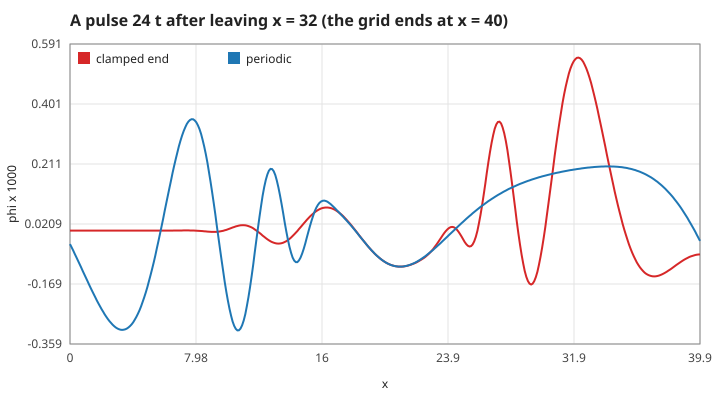
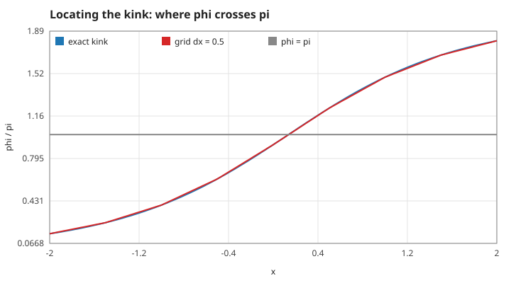
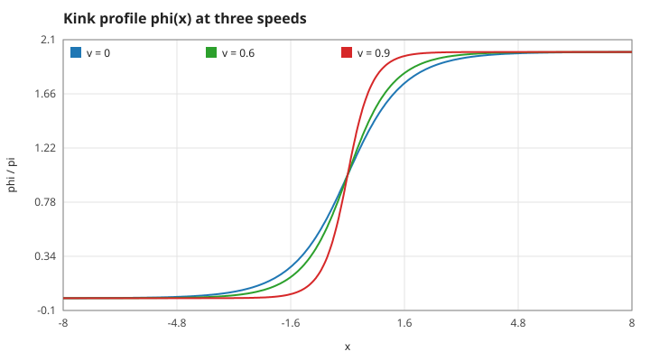
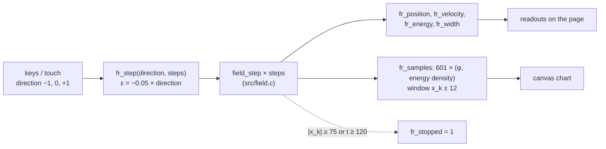

# 4. Boundaries and what the instruments read

## S15 — Ends of the grid: clamped or periodic

**Statement.** A neighbour outside the grid is replaced by

- **clamped** (`periodic = 0`): the nearest end point, $\phi_{-1} = \phi_0$ and $\phi_{n} = \phi_{n-1}$ — a free end with zero gradient, which reflects waves without changing their sign;
- **periodic** (`periodic = 1`): the point on the other side, $\phi_{-1} = \phi_{n-1}$ and $\phi_n = \phi_0$.

*Figure: the same right-moving pulse 24 time units after leaving $x = 32$ on a grid that ends at $x = 40$. With a clamped end it has turned back from the wall (red); with a periodic grid it has re-entered from the left (blue). The pulse spreads because short and long waves travel at different speeds (S03).*

**Assumptions and where they break.** A kink needs different vacua at the two ends, so kinks are only run on clamped grids; a kink that reaches an end is no longer a solution. The observatory stops at $|x| \ge 75$ of 100 and The Flood Line counts $|x| > 52$ of 60 as a lost turn.

**Derivation.** Copying the end value makes the one-sided difference vanish, i.e. $\phi_x = 0$ at the wall: the mirror-image (Neumann) condition.

**Code.** `at` in `src/field.c` (used by `field_step`, `field_gradient`, `field_energy`); the stop rules are in `fr_step` (`src/observer.c`) and `RUNOFF` (`src/line.c`).

**Tests.** `test_small_waves_follow_the_massive_dispersion` (periodic); every kink test (clamped).

## S16 — Where the kink is: the crossing of $\pi$

**Statement.** The position is the point where $\phi$ rises through $\pi$, found by linear interpolation between the two grid points that bracket it:

$$x_k = x_j + dx\,\frac{\pi - \phi_j}{\phi_{j+1} - \phi_j}, \qquad \phi_j < \pi \le \phi_{j+1}.$$

If no such pair exists the position is "not a number".

*Figure: an exact kink centred at 0.137 (blue), a deliberately coarse grid with $dx = 0.5$ (red segments) and the level $\pi$ (grey). The crossing of the red segment is the reported position.*

**Assumptions and where they break.** Only a rising crossing is detected, so an antikink alone gives no position. The interpolation error is $O(dx^2)$: $1.8\times10^{-3}$ at $dx = 0.5$ (`position-dx0.5`), $1\times10^{-5}$ on the game's grid (`position-dx0.1`). Large ripples that cross $\pi$ elsewhere move the reading; The Flood Line treats a jump of more than 2 units in one frame as a turn shaken loose.

**Derivation.** The kink is antisymmetric about its centre, where $\phi = \pi$ exactly; a straight line through the two neighbouring samples has no first-order error there.

**Code.** `field_kink_position` in `src/field.c`; the jump rule is in `line_tick` (`src/line.c`).

**Tests.** `test_moving_kink_follows_its_worldline`; `tests/test_observer.c` (the adapter reports the same position).

## S17 — Speed and width as read from the grid

**Statement.** Speed is the change of the position S16 over the elapsed time, $v = \Delta x_k/\Delta t$ (one solver step in the observatory, one frame of four steps in The Flood Line). Width is $2/\max_j |g_j|$ with the centred gradient $g_j$ (S07).

*Figure: the slope at the centre is the largest gradient; it grows like $\gamma$, so the width read from it shrinks like $1/\gamma$.*

**Assumptions and where they break.** The speed is an average over the interval, so it lags an accelerating kink by half an interval. The width uses the largest gradient anywhere on the grid, so a steep ripple elsewhere would be read as a narrow kink.

**Derivation.** Finite differences of S16 and S07.

**Code.** `fr_step`, `fr_velocity`, `fr_width` in `src/observer.c`; `l->v` in `line_tick` (`src/line.c`); `field_max_gradient` in `src/field.c`.

**Tests.** `test_kink_is_lorentz_contracted`; `tests/test_observer.c` (`fr_width` within 0.02 of 0.8 at $v = 0.6$).

## S18 — From the solver to the screen

**Statement.** The browser shows the solver's own arrays. Each animation frame takes whole solver steps, then reads 601 samples of $\phi$ and of the energy density over the window $[x_k - 12,\ x_k + 12]$ around the kink, linearly interpolated from the grid.

*Figure: the data path of the observatory. The same C file runs natively in the tests and as WebAssembly in the page.*

**Assumptions.** The chart is a window that follows the kink, so the kink always appears centred; the position readout carries the motion.

**Derivation.** Not a physical law: a statement of what is drawn, so that the chart can be trusted as data.

**Code.** `fr_reset`, `fr_step`, `fr_samples`, `fr_count`, `fr_time`, `fr_stopped` in `src/observer.c`; the terminal view uses `render_frame` in `src/render.c`.

**Tests.** `tests/test_observer.c` (`fr_count`, sample values finite, energy density non-negative, the centre sample of the window within 0.002 of $\pi$); `test_render_fits_the_screen` in `tests/test_field.c`.
