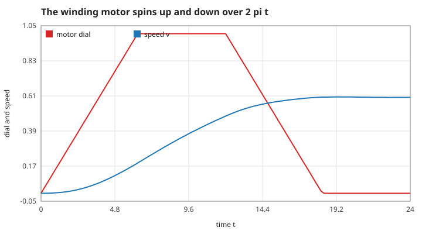
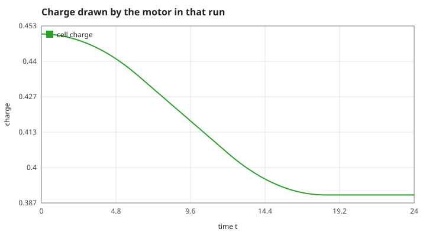
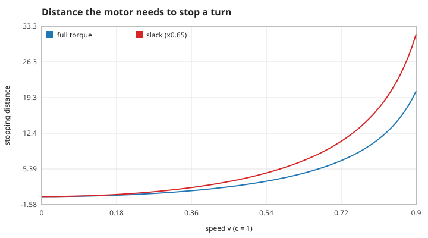
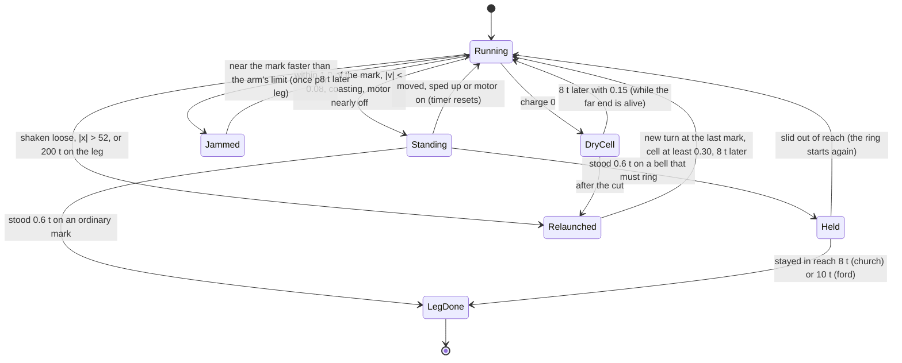
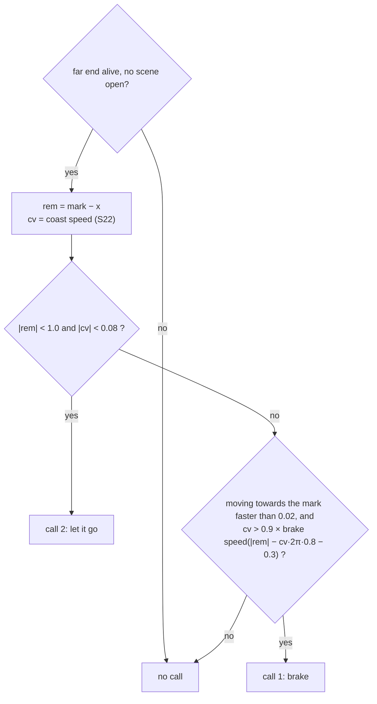
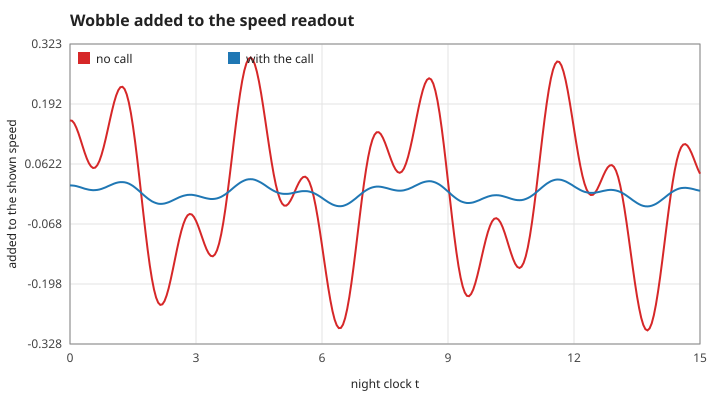

# 5. The Flood Line: the rules of the game layer

`src/line.c` adds a game on top of the unchanged solver. The turn is a kink (S05); the winding motor is the bias $\varepsilon$ (S09). Grid: 1200 points over $x \in [-60, 60)$, $dx = 0.1$, $dt = 0.05$; one frame is four solver steps ($0.2\,t$). All constants below are the `#define`s at the top of `src/line.c`.

## S19 — The motor spins up and down over $2\pi$

**Statement.** The motor's full torque is $|\varepsilon| = 0.08$ (a force $2\pi\varepsilon = 0.50$ on the turn). The bias never jumps: each solver step moves it towards the commanded value by at most $0.08\,dt/2\pi$, so a full swing from stopped to full takes $2\pi \approx 6.28\,t$.

*Figure: "run down the valley" for 12 *t*, then "coast". The dial (red) rises linearly to 1 in $2\pi$, and falls the same way; the turn's speed (blue) keeps changing while the dial falls.*

**Assumptions and where they break.** $2\pi$ is the period of the slowest wave of the line (S03). A torque applied faster than that leaves the whole line ringing; ripples that cross $\pi$ corrupt the position reading (S16).

**Derivation.** A design rule, not a theorem: an adiabatic change of $\varepsilon$ keeps the field near the shifted vacuum $\sin\phi = \varepsilon$.

**Code.** `line_tick` (the lines that update `l->field.eps`), `line_motor`, `line_torque` in `src/line.c`; `LINE_RAMP` in `src/line.h`.

**Tests.** `tests/test_line.c` ("[mech] hut" onwards all drive the motor through this ramp); measured value `motor-ramp` (dial 0.987 one frame short of $2\pi$).

## S20 — The cell: drain, leak, and what refills it

**Statement.** While the motor turns, the cell loses $0.005 \times |\text{dial}|$ per unit time. In leg 4, after the spill, a wet cell also bleeds $0.014$ per unit time whether the motor runs or not. Charge comes back only from story events (table in S24). Below $0.30$ the gauge is red.

*Figure: the cell during the run of S19. The charge used is $0.005\times\int|\text{dial}|\,dt = 0.005\times12 = 0.06$ (`motor-drain`).*

**Assumptions.** The leak stops while the turn is held on a ringing bell, and on the ford branch (the dry cell bypasses the wet one).

**Derivation.** Bookkeeping: the ramp-up and ramp-down triangles of S19 each contribute $\pi$ to the integral of the dial and the plateau contributes $(12 - 2\pi)$, so the total equals the run time, 12.

**Code.** `line_tick` (the `l->charge` update), `line_leak` in `src/line.c`; `LINE_RED_LINE` in `src/line.h`.

**Tests.** `tests/test_line.c`: "[mech] spill" (the leak), "[mech] bell", "[mech] ford" (refills).

## S21 — Stopping distance and its inverse

**Statement.** Treating the turn as a particle of mass 8 under the constant braking force $F = 2\pi\varepsilon$, the distance needed to stop from speed $v$ is

$$d(v) = \frac{8\,(\gamma - 1)}{F}, \qquad\text{and conversely}\qquad v(d) = \sqrt{1 - \Big(1 + \frac{F d}{8}\Big)^{-2}} .$$

*Figure: $d(v)$ at full torque (blue) and with the slack line of the last leg, torque $\times0.65$ (red).*

**Assumptions and where they break.** A particle approximation (S09) with the full torque applied at once; the real motor needs the ramp of S19 first, so the game's cue (S25) subtracts the distance covered during the ramp. Speeds above 0.95 are clipped.

**Derivation.** Work–energy: the kinetic energy $8(\gamma - 1)$ equals $F\,d$.

**Code.** `line_stop_distance`, `line_brake_speed`, `line_torque` in `src/line.c`.

**Tests.** `tests/test_line.c` ("[mech] cut" checks the $\times0.65$ torque); measured values `stop-distance-v0.5` (2.46214), `brake-speed-inverse` (0.5 recovered), `torque-slack` (0.65).

## S22 — The coast-speed estimate

**Statement.** If the motor is switched off while its bias is $e$, it still takes $|e|\cdot2\pi/0.08$ to spin down, at a falling torque. The speed shown beside the readout adds half of what the present torque would give over that time:

$$v_\text{coast} \approx v + \frac{2\pi e}{8}\cdot\frac{|e|\,2\pi}{0.08}\cdot\frac12 .$$

*Figure: after the switch-off at $t = 12$ the speed (blue) goes on rising until the dial (red) reaches zero; the estimate predicts where it levels off.*

**Assumptions and where they break.** Non-relativistic ($\Delta v = F\,\Delta t/8$), valid for the game's speeds of a few tenths; a linear spin-down, hence the factor one half.

**Derivation.** The impulse of a linearly falling force $F_0$ over time $T$ is $\tfrac12F_0T$; divide by the mass 8.

**Code.** `line_coast_speed` in `src/line.c`.

**Tests.** No assertion in `make test`: the estimate is only displayed (beside the speed readout in `web/app.mjs`) and feeds the call of S25. `make theory-figs` records one value (`cue-estimate`).

## S23 — Parking a turn on a mark

**Statement.** A leg ends when the turn stands within 1.0 of the mark, slower than 0.08, with the command "coast" and the bias below a tenth of full, for $0.6\,t$. On the church and ford marks it must then stay within reach while the bell rings (8 and 10 *t*). A turn that meets the catch arm faster than the arm's limit jams the motor for $8\,t$ (once per leg).

*Figure: the life of one leg. Every arrow is a condition tested once per frame in `line_tick`.*

**Assumptions.** Arm limits: 0.30 at the far-end marks, 0.15 at the ford bell, 0.04 at the dam road after the cut.

**Derivation.** Game rules.

**Code.** `line_tick`, `line_arm_limit`, `line_hold_need` in `src/line.c`; `LINE_LEG_LIMIT` in `src/line.h`.

**Tests.** `tests/test_line.c`: "[mech] stones" (the church hold), "[mech] ford" (the hold and the fast-turn jam), "[mech] cut" (a dry cell loses the turn).

## S24 — Scenes: fixed order, and the numbers each one changes

**Statement.** Scenes open only at fixed progress points (the start of the night and the end of each leg). While one is open the clock stands still. A scene changes numbers of the game and nothing else; each change is one bit of `effects`, so the benchmark can remove them one at a time.

```mermaid
stateDiagram-v2
    [*] --> Hut
    Hut --> Leg1: cell 0.10 → 0.45, the call steadies the readout ×0.10
    Leg1 --> Stones: mark 18 held
    Stones --> Leg2: choice — mill (mark 30) or church (mark 42, hold 8 t, +0.20)
    Leg2 --> Bell: mark held
    Bell --> Spill: +0.45 from the board cell
    Spill --> Leg3: (heavy scene, no banner)
    Leg3 --> Ford: mark 20 held
    Ford --> Leg4: choice — ford bell (mark 49, +0.40, hold 10 t) or hill siren (mark 32)
    Leg4 --> Cut: mark held; the wet cell bled 0.014 per t on the siren branch
    Cut --> Leg5: the call is gone; torque ×0.65
    Leg5 --> Dawn: mark −10 held
    Dawn --> [*]
```

| Scene | Effect bit | What changes |
|---|---|---|
| Hut | `LE_HUT` | cell $0.10 \to 0.45$; while the far end calls, readout wobble $\times0.10$ |
| Stones | `LE_ROUTE` | mill: mark 30. Church: mark 42, hold $8\,t$, $+0.20$ when its bell starts |
| Bell | `LE_BOARD` | $+0.45$ |
| Spill | `LE_SPILL` | leg 4: leak $0.014$ per $t$, wobble $+0.03$ |
| Ford | `LE_FORD` | ford bell: mark 49, $+0.40$, hold 10 *t*, arm limit 0.15, no leak. Siren: mark 32 |
| Cut | `LE_CUT` | leg 5: the call stops, torque $\times0.65$, arm limit 0.04, a dry cell loses the turn |

*Figure and table: the order of the night and the constants behind each scene.*

**Assumptions.** With an effect bit cleared the scene still opens but changes nothing (used by the benchmark).

**Derivation.** Game rules.

**Code.** `line_init`, `line_answer`, `line_options`, `line_heavy`, `line_ending`, `line_value` in `src/line.c`; the bits are the `LE_*` enum of `src/line.h`.

**Tests.** `tests/test_line.c`: "[mech] hut", "[mech] stones", "[mech] bell", "[mech] spill", "[mech] ford", "[mech] cut", "[quiet] spill", "[quiet] ford", "[quiet] cut", and "[beat]" (each tagged beat changes both outcomes when only its numbers are removed).

## S25 — The call from the far end

**Statement.** While the far end is alive it reads the true turn and calls

- **"brake"** when the coast speed towards the mark exceeds 0.9 of the speed from which the motor can still stop in the remaining distance (less the ramp distance and a third of the arm's reach);
- **"let it go"** when the turn is within 1.0 of the mark with a coast speed below 0.08.

*Figure: the decision made every frame by `line_cue`.*

**Assumptions.** The call uses the true position and speed, not the wobbling readout (S26). After the cut there is no call.

**Derivation.** S21 and S22 combined with a safety factor.

**Code.** `line_cue` in `src/line.c`.

**Tests.** No assertion in `make test`: the call is advice shown on the page (`web/app.mjs`), and the bench policy in `tests/line_policy.h` reads only the instruments, not the call. `make theory-figs` records its three answers and its silence after the cut on hand-set states (`cue-on-mark`, `cue-brake`, `cue-nothing`, `cue-silent`).

## S26 — The readout wobble

**Statement.** The speed shown to the player is the true speed plus

$$A\,\big[0.6\sin(1.7t + 0.3) + 0.4\sin(4.3t + 2.1)\big],$$

with $A = 0.30$ when nobody reads the far end, $\times0.10$ while the call is alive, and $+0.03$ in leg 4 after the spill. It depends only on the night clock, so it is the same for every player and every run.

*Figure: the term added to the readout over 15 *t*, without the call (red) and with it (blue); the ratio of the peaks is 0.10 (`wobble-call`).*

**Assumptions.** Deterministic: no random numbers anywhere in the game.

**Derivation.** Game rule.

**Code.** `line_wobble` in `src/line.c`.

**Tests.** `tests/test_line.c`: "[mech] hut" (the $\times0.10$), "[mech] spill" (the needle shakes more).
