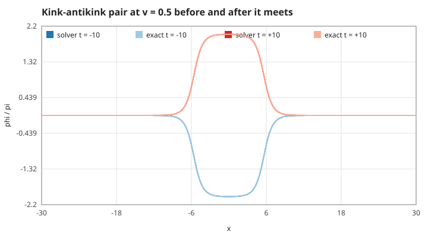
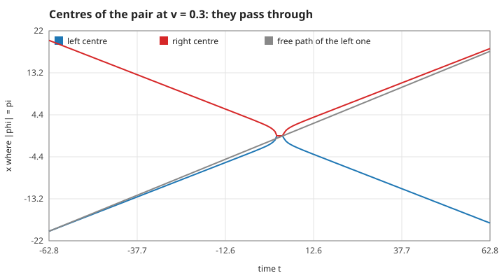
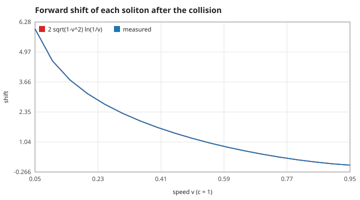
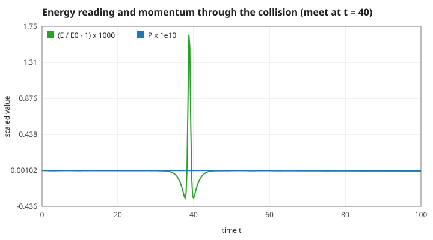
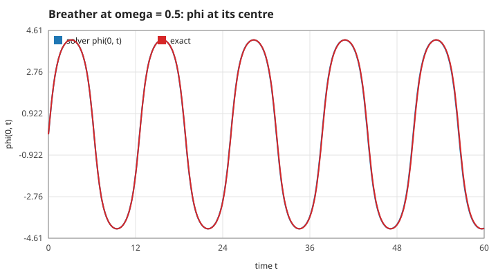
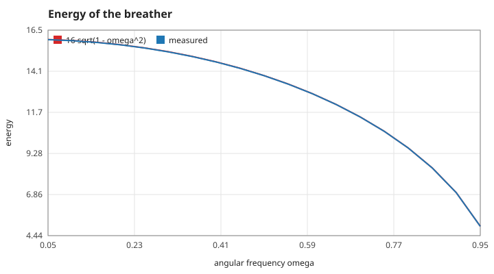
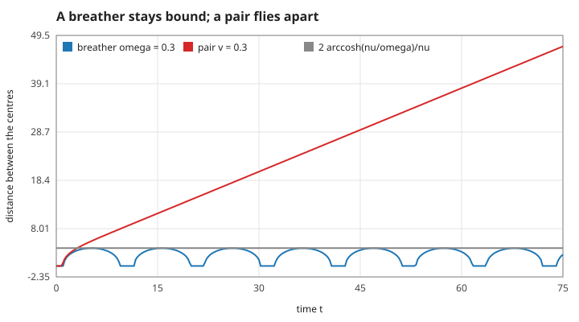
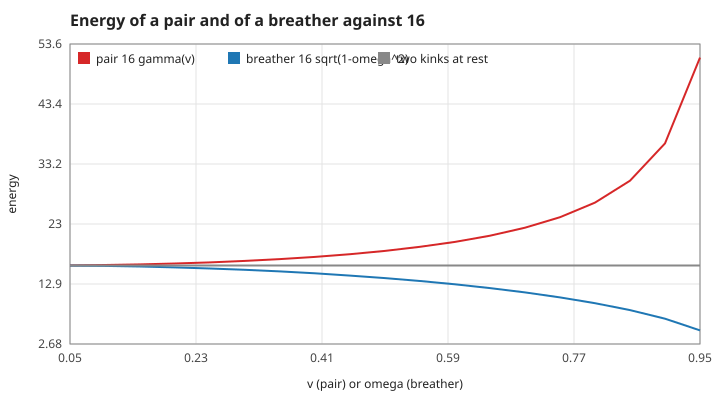
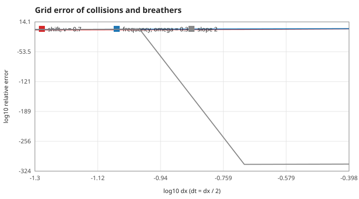
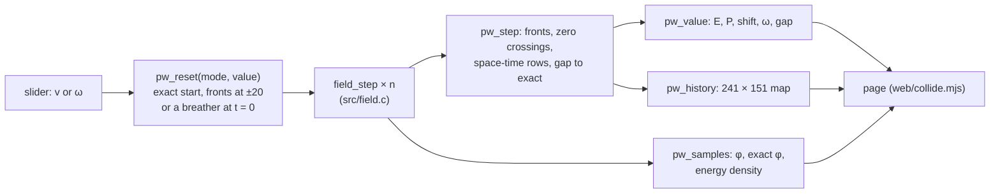

# 6. Collisions and breathers

Two solitons at once. All numbers below come from `make theory-figs` ([figures/values.md](figures/values.md)) or from `make test` (`tests/test_pair.c`), on the game's grid $dx = 0.1$, $dt = 0.05$ unless stated. No bias here: $\varepsilon = 0$.

## S27 — The kink–antikink solution (Perring–Skyrme)

**Statement.** For $0 < v < 1$ and $\gamma = 1/\sqrt{1-v^2}$,

$$\phi(x,t) = 4\arctan\frac{\sinh(\gamma v t)}{v\cosh(\gamma x)}$$

solves S01 exactly. For $t \to -\infty$ it is an antikink on the left and a kink on the right, each moving towards $x = 0$ at speed $v$; they meet at $t = 0$, when $\phi = 0$ everywhere, and for $t \to +\infty$ the field between them has gone from $-2\pi$ to $+2\pi$.

*Figure: the solver (dark) started from this formula at $t = -40$, against the formula (light) at $t = -10$ and $t = +10$, $v = 0.5$.*

**Assumptions and where they break.** $\varepsilon = 0$ and an infinite line; the grid ends at $\pm60$ are flat ($\phi \to 0$ like $e^{-\gamma|x|}$). On the grid each soliton runs slightly slow (S14: 0.49973 instead of 0.5), so the solver lags the formula where $\phi$ is steepest: the largest gap over $t = -40 \dots 40$ is 0.100 rad (`pair-gap-v0.5`), and 0.025 rad with $dx$ halved (a factor 4: second order).

**Derivation.** The form $\tan(\phi/4) = F(t)/G(x)$ separates the sine-Gordon equation into two ordinary differential equations (Perring and Skyrme, 1962); this pair is one of its solutions. Rather than repeat that algebra, the code checks the formula directly: the residual $\phi_{tt} - \phi_{xx} + \sin\phi$ evaluated by central differences with step $1\times10^{-3}$ is at most $8.7\times10^{-7}$ on $|x|, |t| \le 10$ (`pair-residual`), the size of the difference formula's own error. The asymptotic form in S28 shows which soliton is where.

**Code.** `sg_pair_exact` and `field_set_pair` (both time levels, $t_0$ and $t_0 - dt$) in `src/pair.c`; the solver is the unchanged `field_step` of `src/field.c`.

**Tests.** `test_pair_follows_perring_skyrme` in `tests/test_pair.c` (gap below 0.15 rad, ratio to the half-spacing grid between 3.5 and 4.5, $\phi = -2\pi$ between them before and $+2\pi$ after).

## S28 — They pass through, and come out ahead by $2\sqrt{1-v^2}\,\ln(1/v)$

**Statement.** The two solitons neither reflect nor annihilate: each keeps its speed and comes out of the collision **ahead** of the path it would have followed alone, by

$$\delta(v) = \frac{2}{\gamma}\ln\frac{1}{v} = 2\sqrt{1-v^2}\,\ln\frac1v .$$

*Figure: where $|\phi| = \pi$ for the pair at $v = 0.3$ (0 while $|\phi| < \pi$ everywhere, when they overlap at $x = 0$); grey is the path the left soliton would have taken alone. After the collision the right centre runs parallel to grey, 2.30 ahead.*

*Figure: the shift measured by `pair_measure_shift` (blue) against $\delta(v)$ (red) for $v = 0.05 \dots 0.95$.*

**Assumptions and where they break.** The shift is defined between the straight paths long before and long after; the fit uses only times when the centres are at least 16 apart, where the interaction $\propto e^{-\gamma d}$ is below $1\times10^{-7}$. The soliton must be resolved: at $v = 0.9$ the width $1/\gamma = 0.44$ is four cells and the shift is 0.8 % low (`shift-v0.9`); at $v = 0.95$ it is three cells and the shift is 9 % off (`shift-v0.95`) — see S33. Sine-Gordon is special: in other kink models (the $\phi^4$ model) a slow pair bounces or merges.

**Derivation.** For large $|t|$ and $|x|$, $\sinh(\gamma v t) \approx \pm\tfrac12 e^{\gamma v|t|}$ and $\cosh(\gamma x) \approx \tfrac12 e^{\gamma|x|}$, so $|\phi| = \pi$ (argument of magnitude 1) where

$$\gamma|x| = \gamma v|t| - \ln v \quad\Longrightarrow\quad |x| = v|t| + \tfrac1\gamma\ln\tfrac1v .$$

The soliton that comes from the left follows $x = vt - \tfrac1\gamma\ln\tfrac1v$ for $t \to -\infty$ and leaves on the right along $x = vt + \tfrac1\gamma\ln\tfrac1v$: the gap between the two lines is $\delta = \tfrac2\gamma\ln\tfrac1v$. The other soliton is the mirror image. Each is advanced: the pair attracts, so each speeds up while they overlap.

**Code.** `sg_pair_shift`; `field_set_superposed_pair` (a free kink plus a free antikink, no interaction built in, so the shift is not put in by hand), `field_fronts` (the centres) and `pair_measure_shift` / `pair_shift_from_tracks` (straight-line fits before and after) in `src/pair.c`.

**Tests.** `test_pair_passes_through_with_the_phase_shift`: for $v = 0.1, 0.3, 0.5, 0.7, 0.9$ two fronts remain, the shift is within 5 % of $\delta(v)$ (measured within 0.04 % for $v \le 0.7$: `shift-v0.1` 4.58317 against 4.58209, `shift-v0.5` 1.20079 against 1.20057), and the speed after equals the speed before to $1\times10^{-3}$ (`speed-out-v0.5`: 0.499725 against 0.499726).

## S29 — Energy ${16}\gamma$, momentum and speed survive the collision

**Statement.** The pair carries $E = 16\gamma$ (two kinks of $8\gamma$) and total momentum $P = -\int\phi_t\phi_x\,dx = 0$; both are the same after the collision as before, and so is each soliton's speed. Sine-Gordon has infinitely many such conserved quantities (it is integrable), which is why solitons come out of any collision unchanged except for the shift of S28.

*Figure: the superposed pair at $v = 0.5$ meets at $t = 40$. The energy reading moves by $1.7\times10^{-3}$ while the two overlap and returns; $P$ stays at the size of rounding.*

**Assumptions and where they break.** $\varepsilon = 0$ (a bias does work on the kinks, S09) and no friction. The grid is not integrable: the discrete equation radiates a little, but on this grid the energy after the collision equals the energy before to $2.2\times10^{-6}$ (`pair-energy-after`). The energy *reading* while the solitons overlap moves by $O(dt^2)$, as the breather shows in S31; it is a property of the discrete formula (S13), not of the dynamics. The superposed start is not exact: its energy is 0.07 % below ${16}\gamma$ (`pair-energy-v0.5`), the same grid error as $8\gamma$ of one kink (S08).

**Derivation.** Energy: S02. Momentum: translation invariance gives $\partial_t(\phi_t\phi_x) = \partial_x(\dots)$, so $\dot P$ is a boundary term (Noether's theorem); one kink has $\phi_t = -v\phi_x$, so $P = v\int\phi_x^2\,dx = 8\gamma v$. The pair is odd under $x \to -x$ in $\phi_x$ and even in $\phi_t$, so its $P$ is exactly 0, and the symmetric grid keeps it at rounding level ($5.8\times10^{-13}$, `pair-momentum`). That speeds and shapes survive follows from the conserved charges beyond $E$ and $P$ (the inverse scattering transform); here we only measure the consequence.

**Code.** `field_momentum`, `sg_pair_energy` in `src/pair.c`; `field_energy` in `src/field.c`.

**Tests.** `test_pair_conserves_energy_momentum_and_speed` (energy after against before $< 10^{-4}$, reading while overlapping $< 5\times10^{-3}$, $|P| < 10^{-9}$, one kink at $v = 0.6$ carries $P = 6 = 8\gamma v$ within 0.5 %).

## S30 — The breather and its frequency

**Statement.** For $0 < \omega < 1$ and $\nu = \sqrt{1-\omega^2}$,

$$\phi(x,t) = 4\arctan\frac{\nu\,\sin(\omega t)}{\omega\cosh(\nu x)}$$

is an exact solution that stays in place and oscillates with angular frequency $\omega = \sqrt{1-\nu^2}$, below the lowest frequency of small waves (1, S03), so it cannot radiate. Its size is $1/\nu$.

*Figure: $\phi(0,t)$ of the solver (blue) against the formula (red), $\omega = 0.5$.*

**Assumptions and where they break.** The core must be resolved: for small $\omega$ the breather is a kink and antikink that separate and race back together near the speed of light (S32), and their width shrinks like a fast kink's. On $dx = 0.1$ the frequency is 0.36 % high at $\omega = 0.3$, 0.94 % at $\omega = 0.2$ and 4 % at $\omega = 0.1$; halving $dx$ divides these by 4 (`omega-0.2-dx0.05`: 0.200464). The browser panel therefore offers $\omega \ge 0.1$ but quotes the measured value next to $\omega$.

**Derivation.** Put $v = iu$ in S27: $\gamma = 1/\sqrt{1+u^2}$, $\sinh(\gamma v t)/v = \sin(\gamma u t)/u$, and the formula becomes $4\arctan\big(\sin(\gamma u t)/(u\cosh\gamma x)\big)$. With $\omega = \gamma u$ and $\nu = \gamma$ one has $\omega^2 + \nu^2 = \gamma^2(u^2 + 1) = 1$ and $u = \omega/\nu$, which is the breather. The continuation keeps S01 satisfied, which the residual check confirms independently: $9.3\times10^{-7}$ (`breather-residual`).

**Code.** `sg_breather_exact`, `field_set_breather`, `field_value_at` and `breather_measure_frequency` (zero crossings of $\phi(0,t)$ over 20 periods) in `src/pair.c`.

**Tests.** `test_breather_keeps_frequency_and_shape`: measured $\omega$ within 1 % for $\omega = 0.3, 0.5, 0.8, 0.95$ (`breather-omega-0.5`: 0.500387; `breather-omega-0.8`: 0.800116); largest gap to the formula over one period at $\omega = 0.5$ below 0.05 rad (0.033).

## S31 — Breather energy ${16}\sqrt{1-\omega^2}$, conserved

**Statement.** The breather's energy is

$$E = 16\,\nu = 16\sqrt{1-\omega^2},$$

constant in time.

*Figure: energy read from the solver's grid at a peak of the breath (blue) against ${16}\sqrt{1-\omega^2}$ (red).*

**Assumptions and where they break.** The discrete energy of S13 reads the kinetic term from two time levels. When the whole field moves fast (the breather passing through $\phi = 0$) that reading is $O(dt^2)$ off: within one breath it swings by $1.55\times10^{-3}$ at $\omega = 0.5$, and by a quarter of that with $dx$ and $dt$ halved (`breather-swing-ratio`: 3.99). Read at the same phase — the peaks, where the field stands still — the energy does not drift: $7.9\times10^{-7}$ over 20 periods (`breather-drift-0.5`).

**Derivation.** By the continuation of S30, ${16}\gamma \to 16/\sqrt{1+u^2} = 16\nu$. Directly: at a peak $\phi_t = 0$ and the energy is $\int\big(\tfrac12\phi_x^2 + 1 - \cos\phi\big)dx$ of the profile $4\arctan\big((\nu/\omega)\,\mathrm{sech}(\nu x)\big)$, which integrates to ${16}\nu$. Conservation is S02.

**Code.** `sg_breather_energy`, `breather_measure_frequency` (energy drift and swing) in `src/pair.c`.

**Tests.** `test_breather_energy` ($\omega = 0.1 \dots 0.9$ within 0.1 %; `breather-energy-0.5`: 13.8485 against 13.8564); `test_breather_keeps_frequency_and_shape` (drift between breaths $< 10^{-4}$, swing $< 10^{-3}$ on the half-spacing grid, ratio of swings between 3.5 and 4.5).

## S32 — Bound or free: the threshold at $E = 16$

**Statement.** A kink and an antikink at rest far apart have $E = 16$. A pair with $E = 16\gamma > 16$ flies apart; a breather with $E = 16\nu < 16$ is the same pair **bound**: the distance between its centres swings between 0 and

$$d_{\max} = \frac{2}{\nu}\,\mathrm{arccosh}\frac{\nu}{\omega} \qquad (\omega < 1/\sqrt2),$$

and for $\omega \ge 1/\sqrt2$ the breather never reaches $|\phi| = \pi$ and has no separate centres at all.

*Figure: distance between the centres of a breather at $\omega = 0.3$ (blue) and of a pair at $v = 0.3$ that has just met (red); grey is $d_{\max}$.*

*Figure: energy of the pair ${16}\gamma(v)$ and of the breather ${16}\sqrt{1-\omega^2}$ against their parameter; both approach 16 from opposite sides.*

**Assumptions and where they break.** "Centre" means $|\phi| = \pi$, as in S16. The binding is exact in sine-Gordon; with friction a fast pair would lose energy and could be captured into a breather, which this solver does not model.

**Derivation.** At a peak $|\sin\omega t| = 1$ and $|\phi| = \pi$ where $\nu = \omega\cosh(\nu x)$, i.e. $x = \pm\mathrm{arccosh}(\nu/\omega)/\nu$; this needs $\nu > \omega$, i.e. $\omega < 1/\sqrt2$. Energies from S29 and S31.

**Code.** `sg_breather_separation`, `field_fronts`, `breather_measure_frequency` (widest separation) in `src/pair.c`.

**Tests.** `test_breather_is_a_bound_pair` (widest separation within 1 % for $\omega = 0.3, 0.5$; none at $\omega = 0.8$); `test_breather_energy` (breather below 16, pair above); measured value `breather-separation-0.3` (3.8168 against 3.82471).

## S33 — What the grid does to collisions and breathers

**Statement.** Every error measured on this page is a grid error of second order: halving $dx$ (and $dt = dx/2$) divides it by 4. It grows with how sharp the solitons are, i.e. with $\gamma^2 dx^2$. A kink on a lattice can also feel a periodic "Peierls–Nabarro" potential; for this equation it is exponentially small in $1/dx$ and invisible even on a coarse grid.

*Figure: relative error of the shift at $v = 0.7$ (red) and of the breather frequency at $\omega = 0.3$ (blue) against $dx = 0.4, 0.2, 0.1, 0.05$; grey has slope 2.*

**Assumptions and where they break.** Second order holds while the soliton spans many cells. At $v = 0.9$ (four cells) the shift error falls by 10 rather than 4 between $dx = 0.1$ and 0.05 — the measurement is no longer in its asymptotic range; at $v = 0.95$ (three cells) the shift is 9 % off. Use a finer grid there.

**Derivation.** The scheme is second order in $dx$ and $dt$ (S13, S14): the kink's speed, the breather's frequency and the shift all inherit an $O(dx^2)$ error, with a coefficient set by the largest gradient $\sim\gamma$. The Peierls–Nabarro barrier of the discretised sine-Gordon chain scales like $e^{-\pi^2/dx}$ ($\approx 10^{-43}$ at $dx = 0.1$), so a slow kink is not pinned: on $dx = 0.4$ a kink at $v = 0.05$ still runs at 0.04965 over $t = 400$ (`slow-kink-dx0.4`), 0.7 % slow from dispersion, without stopping.

**Code.** `field_step` in `src/field.c` (the scheme); `pair_measure_shift` and `breather_measure_frequency` take $dx$ as an argument.

**Tests.** `test_pair_passes_through_with_the_phase_shift` (shift error ratio between $dx = 0.1$ and 0.05 at $v = 0.7$ between 3.5 and 4.5); measured values `shift-order` (3.9982 against 4) and `omega-order` (4.0032 against 4).

## S34 — From the solver to the collision panel

**Statement.** The browser panel "Collisions and breathers" shows only numbers computed by `src/pair.c` over `src/field.c` on the game's grid: the field and the exact formula over $x \in [-30, 30]$, the energy density, a space-time map of $\phi$, and the measured shift, frequency, energy, momentum and largest gap to the formula. JavaScript draws them and holds the sliders; it computes nothing physical.

*Figure: the path of every number on the panel.*

**Assumptions.** The panel runs the pair from fronts at $\pm20$ to $\pm20$ on the other side ($t$ from $-(20 - \ln(1/v)/\gamma)/v$ to the same positive time) and the breather for four periods. The terminal program draws the same two space-time maps into `docs/collision.gif` (`./field-ripple --collide docs`, part of `make plots`).

**Derivation.** Not a law: the wiring that keeps the screen honest.

**Code.** `pw_reset`, `pw_step`, `pw_value`, `pw_samples`, `pw_history`, `pw_count`, `pw_columns`, `pw_rows` in `src/pair_web.c`.

**Tests.** `test_browser_adapter` in `tests/test_pair.c` (the adapter steps exactly like `field_step` from the same start; panel shift within 5 %, full map, $|P| < 10^{-9}$, breather $\omega$ within 1 %); `make smoke` reads the same values through WebAssembly.
