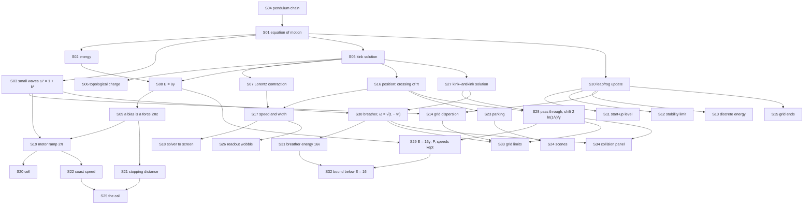

# Theory handbook

Why the program is correct, from the repository alone: every law, theorem, numerical rule and game rule the code relies on, each stated in Markdown **with a figure**, the place in the code that implements it, and the test that checks it.

- Units: $c = 1$; lengths and times in the field's own units; $\phi$ in radians; the resting kink has energy 8.
- Plotted figures and the numbers quoted in the text are produced by the solver itself: `make theory-figs` rewrites [figures/](figures/) and [figures/values.md](figures/values.md). Diagrams are Mermaid, written in the pages.
- `make theory-check` fails when a statement has no figure, a link is broken, a referenced function or test no longer exists, or a public function is missing from the tables below.

## Pages

1. [The sine-Gordon field](01-sine-gordon.md) — equation of motion, energy, small waves, the pendulum chain
2. [The kink](02-kink.md) — the solution, topological charge, Lorentz contraction, $E = 8\gamma$, the force of a bias
3. [The numerical scheme](03-leapfrog.md) — leapfrog stencil, start-up, stability limit, energy error, grid dispersion
4. [Boundaries and what the instruments read](04-boundaries-and-measurement.md) — grid ends, position, speed and width, the path to the screen
5. [The Flood Line: the rules of the game layer](05-flood-line.md) — motor ramp, cell, stopping distance, parking, scenes, the call, the readout
6. [Collisions and breathers](06-collisions-and-breathers.md) — the kink–antikink solution, passing through with a phase shift, conserved quantities, the breather, bound against free, grid limits, the collision panel

## How the pieces depend on each other

## Coverage: statement → page → figure → code → test

| ID | Statement | Page | Figure | Code | Test |
|---|---|---|---|---|---|
| S01 | Equation of motion $\phi_{tt} = \phi_{xx} - \sin\phi + \varepsilon$ | [1](01-sine-gordon.md) | `figures/potential.svg` | `src/field.c#field_step` | `tests/test_field.c#test_static_kink_stays_put_with_energy_eight` |
| S02 | Lagrangian and conserved energy | [1](01-sine-gordon.md) | `figures/energy-density.svg` | `src/field.c#field_energy` | `tests/test_field.c#test_energy_is_gamma_times_rest_energy` |
| S03 | Small waves: $\omega^2 = 1 + k^2$ | [1](01-sine-gordon.md) | `figures/dispersion.svg` | `src/field.c#field_set_wave` | `tests/test_field.c#test_small_waves_follow_the_massive_dispersion` |
| S04 | The pendulum-chain model | [1](01-sine-gordon.md) | mermaid | `src/line.c#line_torque` | `tests/test_line.c#[mech] hut` |
| S05 | Kink solution $4\arctan e^{\gamma(x - vt)}$ | [2](02-kink.md) | `figures/kink-profiles.svg` | `src/field.c#field_set_kink` | `tests/test_field.c#test_moving_kink_follows_its_worldline` |
| S06 | Topological charge | [2](02-kink.md) | mermaid | `src/field.c#field_set_kink` | `tests/test_field.c#test_static_kink_stays_put_with_energy_eight` |
| S07 | Lorentz contraction, width $1/\gamma$ | [2](02-kink.md) | `figures/contraction.svg` | `src/field.c#field_max_gradient`, `src/field.c#field_gradient`, `src/observer.c#fr_width` | `tests/test_field.c#test_kink_is_lorentz_contracted` |
| S08 | Rest energy 8, $E = 8\gamma$ | [2](02-kink.md) | `figures/energy-gamma.svg` | `src/field.c#field_energy`, `src/observer.c#fr_energy` | `tests/test_field.c#test_energy_is_gamma_times_rest_energy` |
| S09 | A bias is a force $2\pi\varepsilon$; $p = Ft$ | [2](02-kink.md) | `figures/push-speed.svg`, `figures/push-momentum.svg` | `src/field.c#field_step`, `src/observer.c#fr_step` | `tests/test_field.c#test_bias_pushes_the_kink_like_a_particle` |
| S10 | Leapfrog update and stencil | [3](03-leapfrog.md) | mermaid | `src/field.c#field_step` | `tests/test_observer.c#fr_position` |
| S11 | Start-up level at $t = -dt$ | [3](03-leapfrog.md) | mermaid | `src/field.c#field_set_kink`, `src/field.c#field_set_wave` | `tests/test_field.c#test_static_kink_stays_put_with_energy_eight` |
| S12 | Stability limit $dt \le 2dx/\sqrt{4 + dx^2}$ | [3](03-leapfrog.md) | `figures/cfl.svg` | `src/observer.c#fr_reset`, `src/line.c#line_init` | `tests/theory_figs.c#cfl-limit` |
| S13 | Discrete energy, second-order accuracy | [3](03-leapfrog.md) | `figures/energy-error.svg` | `src/field.c#field_energy` | `tests/theory_figs.c#energy-error-ratio` |
| S14 | Grid dispersion relation | [3](03-leapfrog.md) | `figures/dispersion.svg` | `src/field.c#field_step` | `tests/theory_figs.c#dispersion-grid-k12.6` |
| S15 | Grid ends: clamped or periodic | [4](04-boundaries-and-measurement.md) | `figures/boundary.svg` | `src/field.c#at(`, `src/field.c#field_init`, `src/field.c#field_x` | `tests/test_field.c#test_small_waves_follow_the_massive_dispersion` |
| S16 | Position: where $\phi$ crosses $\pi$ | [4](04-boundaries-and-measurement.md) | `figures/position.svg` | `src/field.c#field_kink_position` | `tests/test_field.c#test_moving_kink_follows_its_worldline` |
| S17 | Speed and width from the grid | [4](04-boundaries-and-measurement.md) | `figures/kink-profiles.svg` | `src/observer.c#fr_velocity`, `src/observer.c#fr_width`, `src/observer.c#fr_position` | `tests/test_observer.c#fr_width` |
| S18 | From the solver to the screen | [4](04-boundaries-and-measurement.md) | mermaid | `src/observer.c#fr_samples`, `src/observer.c#fr_count`, `src/observer.c#fr_time`, `src/observer.c#fr_stopped`, `src/render.c#render_frame` | `tests/test_observer.c#fr_count` |
| S19 | Motor ramp over $2\pi$ | [5](05-flood-line.md) | `figures/motor-ramp.svg` | `src/line.c#line_tick`, `src/line.c#line_motor`, `src/line.c#line_torque` | `tests/theory_figs.c#motor-ramp` |
| S20 | Cell: drain, leak, refills | [5](05-flood-line.md) | `figures/motor-charge.svg` | `src/line.c#line_leak`, `src/line.c#line_tick` | `tests/test_line.c#[mech] spill` |
| S21 | Stopping distance $8(\gamma - 1)/F$ and inverse | [5](05-flood-line.md) | `figures/stop-distance.svg` | `src/line.c#line_stop_distance`, `src/line.c#line_brake_speed` | `tests/theory_figs.c#brake-speed-inverse` |
| S22 | Coast-speed estimate | [5](05-flood-line.md) | `figures/motor-ramp.svg` | `src/line.c#line_coast_speed` | `tests/theory_figs.c#cue-estimate` |
| S23 | Parking a turn on a mark | [5](05-flood-line.md) | mermaid | `src/line.c#line_tick`, `src/line.c#line_arm_limit`, `src/line.c#line_hold_need` | `tests/test_line.c#[mech] stones` |
| S24 | Scenes and the numbers they change | [5](05-flood-line.md) | mermaid | `src/line.c#line_answer`, `src/line.c#line_options`, `src/line.c#line_heavy`, `src/line.c#line_ending`, `src/line.c#line_value` | `tests/test_line.c#[beat]` |
| S25 | The call from the far end | [5](05-flood-line.md) | mermaid | `src/line.c#line_cue` | `tests/theory_figs.c#cue-brake` |
| S26 | Readout wobble | [5](05-flood-line.md) | `figures/wobble.svg` | `src/line.c#line_wobble` | `tests/theory_figs.c#wobble-call` |
| S27 | Kink–antikink solution $4\arctan\frac{\sinh\gamma vt}{v\cosh\gamma x}$ | [6](06-collisions-and-breathers.md) | `figures/pair-snapshots.svg` | `src/pair.c#sg_pair_exact`, `src/pair.c#field_set_pair` | `tests/test_pair.c#test_pair_follows_perring_skyrme` |
| S28 | They pass through, ahead by $2\sqrt{1-v^2}\ln(1/v)$ | [6](06-collisions-and-breathers.md) | `figures/pair-worldlines.svg`, `figures/pair-shift.svg` | `src/pair.c#sg_pair_shift`, `src/pair.c#field_set_superposed_pair`, `src/pair.c#field_fronts`, `src/pair.c#pair_measure_shift`, `src/pair.c#pair_shift_from_tracks` | `tests/test_pair.c#test_pair_passes_through_with_the_phase_shift` |
| S29 | Energy ${16}\gamma$, momentum and speed survive | [6](06-collisions-and-breathers.md) | `figures/pair-conserved.svg` | `src/pair.c#field_momentum`, `src/pair.c#sg_pair_energy` | `tests/test_pair.c#test_pair_conserves_energy_momentum_and_speed` |
| S30 | Breather, frequency $\omega = \sqrt{1-\nu^2}$ | [6](06-collisions-and-breathers.md) | `figures/breather-centre.svg` | `src/pair.c#sg_breather_exact`, `src/pair.c#field_set_breather`, `src/pair.c#field_value_at`, `src/pair.c#breather_measure_frequency` | `tests/test_pair.c#test_breather_keeps_frequency_and_shape` |
| S31 | Breather energy ${16}\sqrt{1-\omega^2}$, conserved | [6](06-collisions-and-breathers.md) | `figures/breather-energy.svg` | `src/pair.c#sg_breather_energy` | `tests/test_pair.c#test_breather_energy` |
| S32 | Bound below $E = 16$, free above | [6](06-collisions-and-breathers.md) | `figures/bound-unbound.svg`, `figures/threshold.svg` | `src/pair.c#sg_breather_separation`, `src/pair.c#field_fronts` | `tests/test_pair.c#test_breather_is_a_bound_pair` |
| S33 | Grid limits: second order, no Peierls–Nabarro pinning | [6](06-collisions-and-breathers.md) | `figures/collision-grid.svg` | `src/field.c#field_step`, `src/pair.c#pair_measure_shift` | `tests/theory_figs.c#shift-order` |
| S34 | From the solver to the collision panel | [6](06-collisions-and-breathers.md) | mermaid | `src/pair_web.c#pw_reset`, `src/pair_web.c#pw_step`, `src/pair_web.c#pw_value`, `src/pair_web.c#pw_samples`, `src/pair_web.c#pw_history` | `tests/test_pair.c#test_browser_adapter` |

Tests named `tests/theory_figs.c#…` are measurements recorded in [figures/values.md](figures/values.md) by `make theory-figs`, not assertions of `make test`. S12–S14, S19, S21, S22, S25 and S26 are covered only that way; turning them into assertions is a follow-up.

## Public functions that state no law

These are plumbing; they appear here so that the check can tell "not a law" from "forgotten".

| Function | What it is |
|---|---|
| `src/field.c#field_free`, `src/line.c#line_free` | release the arrays |
| `src/svg.c#svg_plot` | writes the line charts of this handbook and of `make plots` |
| `src/gif.c#gif_open`, `src/gif.c#gif_frame`, `src/gif.c#gif_close`, `src/gif.c#gif_text_size`, `src/gif.c#gif_draw_text` | GIF89a/LZW encoder for the demo animation |

## Reading the source against this table

Functions reviewed for this handbook: every declaration in `src/field.h`, `src/observer.h`, `src/line.h`, `src/pair.h`, `src/render.h`, `src/svg.h` and `src/gif.h`, plus the static helper `at` in `src/field.c` and the entry points of `src/pair_web.c` (S34). `src/main.c` (terminal program, plots and the space-time maps of `--collide`) and `src/line_web.c` (WebAssembly wrapper of `line.c`) call these functions and state no law of their own.
